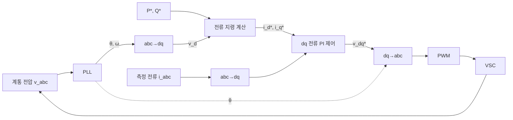

# GFL 제어 구조 — PLL, dq 전류제어

> 요약: 현재 대다수 계통연계 인버터가 쓰는 계통추종(GFL) 제어의 블록 구조, PLL 동작, 전력 지령 → 전류 지령 변환, 계통지원 기능(FRT, 주파수·전압 응동)을 정리한다.
> 최종 갱신: 2026-11-01 · 상태: 초안

## 핵심 요약 (TL;DR)

- GFL = **PLL로 계통 위상을 읽고**, 그 위상 기준으로 **dq 전류를 제어**하는 전류원형 인버터.
- 장점: 구조가 단순, 출력전력 제어가 정확, 전류 제한이 자연스러움, 강계통에서 검증된 기술.
- 계통지원 기능(저전압 통과 FRT, 동적 무효전류, 주파수-와트 응동, 합성관성)을 덧붙일 수 있으나 모두 **측정 → 응답** 구조라 지연과 측정 오류의 영향을 받는다.

## 1. 블록 구조

## 2. 위상동기루프 (PLL)

가장 흔한 SRF-PLL(Synchronous Reference Frame PLL):

$$v_q \xrightarrow{\;PI\;} \Delta\omega \;\to\; \omega = \omega_0 + \Delta\omega \;\xrightarrow{\;1/s\;} \theta$$

- $v_q = 0$이 되도록 $\theta$를 조절하면 d축이 계통 전압 벡터에 정렬된다.
- 대역폭 설계: 빠르면(수십 Hz) 응답은 좋으나 고조파·불평형·약계통에 취약, 느리면(수 Hz) 외란에 둔감하나 위상 점프 추종이 느리다.
- 불평형·고조파 대응 변형: DDSRF-PLL, DSOGI-PLL(정상분 추출), EPLL, MAF-PLL 등.
- **약계통 문제의 근원**: PLL은 PCC 전압을 측정하는데, 그 전압은 인버터 자신의 전류 × 계통 임피던스에 의해 흔들린다. 즉 PLL 루프 안에 계통 임피던스가 들어가 **자기 자신을 쫓는** 양의 되먹임이 생긴다. → [GFL의 한계](02-GFL-한계-약계통.md)

## 3. 전류 지령 계산

d축을 전압에 정렬($v_q=0$)하면

$$i_d^* = \frac{2}{3}\frac{P^*}{v_d}, \qquad i_q^* = -\frac{2}{3}\frac{Q^*}{v_d}$$

- 계통 전압 $v_d$가 떨어지면 같은 $P^*$에 대해 전류가 커지므로 **전류 제한기**(크기 $\sqrt{i_d^2+i_q^2} \le I_{max}$)를 둔다. 제한 시 우선순위(P 우선 / Q 우선)는 계통코드가 정하는 경우가 많다(고장 중에는 보통 무효전류 우선).
- 대안으로 외부 PI 루프(P, Q 또는 DC링크 전압 제어)를 두어 $i^*$를 생성한다. PV 인버터는 보통 $i_d^*$를 **DC링크 전압 제어**로 만든다.

## 4. 계통지원 기능 (Grid-Support Functions)

| 기능 | 동작 | 관련 표준 |
|---|---|---|
| 저전압/고전압 통과 (LVRT/HVRT) | 고장 중 탈락하지 않고 접속 유지 | IEEE 1547-2018, IEEE 2800-2022, 국내 송배전용전기설비 이용규정 |
| 동적 무효전류 주입 | $\Delta i_q = k \cdot \Delta V$ (k = 2~6 pu/pu) | 독일 VDE-AR-N 4120/4130, IEEE 2800 |
| 주파수-와트 (f-P droop) | 과주파수 시 출력 감소, 저주파수 시 증가(여유 있으면) | 1547, 2800, 국내 규정 |
| 전압-무효전력 (Volt-VAr) | Q = f(V) 곡선 | 1547, 2800 |
| 합성 관성 / FFR | $\Delta P = -K \cdot df/dt$ 또는 주파수 임계 트리거 후 고정 출력 | 각국 보조서비스 (영국 Dynamic Containment 등) |
| 전력진동 감쇠 (POD) | 측정 신호 기반 변조 | 선택적 |

모두 "측정 후 응답"이다. 측정 창(window)·필터링 때문에 통상 50~500 ms 지연이 있고, 외란 직후 전압·주파수 측정이 왜곡되면 오응답 가능성이 있다. 이 구조적 한계가 GFM 도입의 직접적 동기다.

## 5. GFL이 잘 맞는 조건

- SCR ≥ 3의 강계통, 동기기가 충분한 지역.
- 정확한 전력 추종(MPPT, 급전 지령)이 중요한 경우.
- 에너지 버퍼가 없거나 작은 PV 전용 인버터.
- 전류 제한이 엄격하고 과부하 설계 비용을 줄이고 싶은 경우.

## 관련 문서

- [GFL의 한계 — 약계통](02-GFL-한계-약계통.md)
- [인버터 기본 구조](../01-기초이론/02-인버터-기본구조-제어계층.md)
- [GFM 제어 구조](../03-GFM/01-GFM-제어구조.md)
