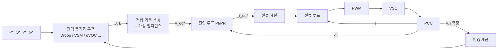

# GFM 제어 구조 — 전압원 동작의 원리

> 요약: 계통형성(GFM) 인버터가 어떻게 자체 위상을 만들고 전압원처럼 행동하는지, 공통 블록 구조(전력 동기화 → 전압 기준 → 전압/전류 캐스케이드 → 전류 제한)를 설명한다.
> 최종 갱신: 2026-11-01 · 상태: 초안

## 핵심 요약 (TL;DR)

- GFM의 본질은 두 가지: ① **위상 $\theta$를 PLL이 아니라 유효전력 균형으로부터 생성**(전력 동기화), ② **전압 크기 $E$를 무효전력·전압 제어로 생성**.
- 그 결과 인버터는 $E\angle\theta$를 가진 전압원이 되고, 계통 전압과의 차이에 의해 전력이 **자동으로** 흐른다. 외란 직후 측정 없이 응답하는 이유다.
- 공통 구조: 전력 동기화 루프 → 전압 기준 생성(가상 임피던스 포함) → (전압 루프 →) 전류 루프 → 전류 제한 → PWM.
- 구체적 기법(Droop, VSM, dVOC, Matching 등)은 "전력 동기화 루프"의 형태가 다를 뿐이다. → [GFM 제어기법](02-GFM-제어기법.md)

## 1. 기본 원리: 전력 동기화 (Power Synchronization)

동기발전기는 기계입력 > 전기출력이면 가속(위상 앞섬), 반대면 감속한다. GFM은 이를 제어로 흉내 낸다.

$$\omega = \omega_0 + f(P^* - P), \qquad \theta = \int \omega\, dt$$

- $P > P^*$ (계통이 인버터로부터 더 많이 끌어감) → $\omega$ 감소 → $\theta$ 뒤처짐 → $\delta$ 감소 → $P$ 감소. **음의 되먹임**으로 저절로 동기화된다.
- 가장 단순한 $f$ = 비례(Droop): $\omega = \omega_0 + m_p(P^* - P)$. 관성을 넣으면 $f$가 1차 지연·적분 형태(VSM).
- 계통 주파수가 떨어지면 $\delta$가 벌어져 $P$가 자동으로 증가한다 — 이것이 **측정 없는 관성/1차 응답**이다.

## 2. 공통 블록 구조

### 2.1 전력 계산
PCC 또는 필터 커패시터 전압과 전류로 $P, Q$를 계산하고 **저역통과 필터**(수 Hz~수십 Hz)로 평활한다. 이 필터의 시정수가 Droop 제어에서 사실상 "가상 관성" 역할을 한다.

### 2.2 전압 기준 생성
- Q–V 드룹: $E = V^* + n_q(Q^* - Q)$ (또는 적분형 AVR).
- **가상 임피던스** $Z_v = R_v + jX_v$: 기준 전압에서 $Z_v \cdot i$를 빼 출력 임피던스를 성형한다. 목적은 ① P/Q 디커플링(X/R 비 조정), ② 병렬 GFM 간 순환전류 억제, ③ **고장 시 전류 제한**(전류 크기에 따라 $Z_v$를 키움).

### 2.3 전압 루프 / 전류 루프 (캐스케이드)
- 전압 루프: 필터 커패시터 전압 $v_C$를 $v^*$에 추종. dq PI 또는 αβ PR(비례공진) 제어.
- 전류 루프: GFL과 동일 구조. 전압 루프가 내는 $i^*$를 추종하고, **전류 제한기**가 그 사이에 위치한다.
- 변형: 단일 루프(전압만 제어, 전류제어 없음 — 빠르나 전류 제한이 어려움), 전압 피드포워드만 두는 구조 등.

### 2.4 동작 모드별 특징
| 모드 | θ 출처 | 전류 제한 | 비고 |
|---|---|---|---|
| 정상 연계 운전 | 전력 동기화 | 비활성 | 전압원 동작 |
| 과전류 (고장) | 전력 동기화 유지 또는 보조 PLL로 전환 | 활성 (전류원 처럼) | 안정 유지가 핵심 과제 |
| 단독운전 / 블랙스타트 | 내부 $\omega_0$ | 부하 돌입 시 활성 | 전압·주파수 직접 결정 |

## 3. 동기기와의 비교로 본 GFM 파라미터

| 동기기 물리량 | GFM 대응 파라미터 | 설계 자유도 |
|---|---|---|
| 관성상수 $H$ | VSM의 $J$ 또는 $H$, Droop의 LPF 시정수 | 소프트웨어로 조정 가능 (단, 에너지 버퍼 한계) |
| 댐핑 $D$ | 드룹 계수 $m_p$, 댐핑 항 | 동기기보다 훨씬 크게 줄 수 있음 |
| 과도 리액턴스 $X'_d$ | 필터 + 가상 리액턴스 $X_v$ | 조정 가능 |
| 여자기/AVR | Q–V 드룹 또는 전압 적분 제어 | 매우 빠름 |
| 단락전류 5~7 pu | 1.2~2 pu | **하드웨어 제약** |

## 4. 설계 시 핵심 과제

1. **전류 제한 중 안정성**: 제한기가 걸리면 전압원이 전류원으로 바뀌어 동기화 토크가 사라진다. → [전류 제한과 고장 대응](03-전류제한-고장대응.md)
2. **강계통에서의 안정성**: 전압원이 매우 낮은 임피던스로 강한 계통에 붙으면 작은 위상 차에도 큰 전력이 흐른다. GFM은 **SCR이 높을수록** 전력 루프 안정 여유가 줄어든다(GFL과 반대). 가상 임피던스·LPF 설계로 해결.
3. **에너지 버퍼**: 관성 응답과 위상 점프 응답에는 즉각적인 유효전력이 필요하다. ESS는 유리, PV는 출력 여유 또는 짧은 과부하 허용 필요.
4. **병렬 GFM 간 상호작용**: 가상 임피던스 불일치·통신 없는 동기화에서 순환 전력, 저주파 진동 가능.
5. **보호 협조**: 단락전류가 작아 과전류 계전기 정정이 어려움. 전압 기반·차동 보호 병행.

## 관련 문서

- [GFM 제어기법](02-GFM-제어기법.md)
- [전류 제한과 고장 대응](03-전류제한-고장대응.md)
- [GFM 핵심 기능](04-GFM-핵심기능.md)
- [GFL 제어 구조](../02-GFL/01-GFL-제어구조.md)
