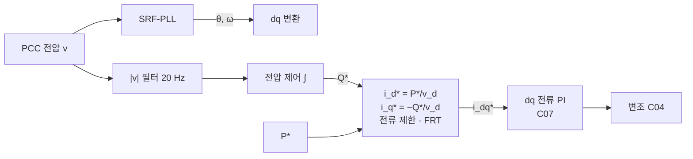

# C08. GFL — PLL로 따라가기

> [!abstract] 이 강의에서 답할 질문
> [[C07-전류-제어]]의 dq 전류 루프는 "어느 각도 θ로 dq 변환을 하느냐"를 정해 주지 않는다. 계통추종(GFL, grid-following)은 이 θ를 **계통 전압에서 측정**한다. 측정한 θ 위에서 전력이 어떻게 전류 지령이 되고, 측정이라는 선택이 어떤 대가를 치르는가?

> [!info] 학습 목표
> - 갈림길(θ를 측정한다 / 만든다)에서 GFL이 선택한 쪽과 그 결과(전류원 등가)를 설명할 수 있다.
> - SRF-PLL의 PI 이득을 고유주파수 $f_n$, 감쇠비 ζ로부터 계산하고, 대역폭 10~50 Hz의 트레이드오프를 말할 수 있다.
> - P/Q 지령에서 $i_d^*, i_q^*$를 계산하고, 전압 제어로 Q 지령을 만드는 구조를 그릴 수 있다.
> - FRT 로직(0.85 pu 진입, 0.92 pu·30 ms 해제, 무효전류 고정 주입)과 약계통에서의 모드 순환을 설명할 수 있다.
> - 위상 점프 때 PLL 측정 주파수가 54 Hz 한계까지 튀는 현상이 왜 위험한지 설명할 수 있다.

## 1. 핵심 개념

### 1.1 갈림길: θ를 측정한다

C07까지 만든 것은 "각도 θ가 주어지면 그 dq 좌표에서 전류를 지령대로 흘리는" 공통 하드웨어·내부 루프다. 이제 θ를 누가 정하느냐가 남는다.

| | GFL (이 강의) | GFM ([[C09-GFM-위상을-만들기]]) |
|---|---|---|
| θ의 출처 | PCC 전압을 **측정** (PLL) | 유효전력 균형으로 **생성** |
| 외부 루프 출력 | 전류 지령 $i_d^*, i_q^*$ | 내부 기전력 $E\angle\theta$ → (가상 임피던스) → 전류 지령 |
| 계통에서 본 모습 | 전류원 | 임피던스 뒤의 전압원 |

같은 하드웨어, 같은 전류 루프에서 **외부 루프만** 다르다. 제어 구조 전체 그림은 [[01-GFL-제어구조]]에 있다. 이 강의는 컨버터 쪽에서 한 단계씩 따라간다.



### 1.2 SRF-PLL: $v_q \to 0$

SRF-PLL(synchronous reference frame PLL)은 PCC 전압을 추정 각 $\theta_c$로 dq 변환하고, $v_q$가 0이 되도록 회전 속도를 조절한다. $v_q = 0$이면 d축이 전압 벡터와 정렬된 것이다.

$$
\Delta\omega = K_p\, v_q + K_i\!\int v_q\,dt,\qquad
\frac{d\theta_c}{dt} = \omega_b\,(1 + \Delta\omega),\qquad
|\Delta\omega| \le 0.1\ \text{pu}
$$

이득은 원하는 고유주파수 $\omega_n = 2\pi f_n$과 감쇠비 ζ(모델 0.707)로 정한다.

$$
K_p = \frac{2\zeta\omega_n}{\omega_b},\qquad K_i = \frac{\omega_n^2}{\omega_b}
$$

모델 기본값 $f_n$ = 20 Hz에서 $K_p$ = 0.471, $K_i$ = 41.9 pu/s다. 주파수는 ±10 %(54~66 Hz)로 제한하고, 제한에 걸리면 적분기를 멈춘다(anti-windup).

> [!note]- 유도: PLL을 2차 시스템으로 보기
> PCC 전압을 $v = V e^{j\theta_g}$, PLL 각을 $\theta_c$라 하면 PLL 좌표의 전압은
> $$v_{dq} = v\,e^{-j\theta_c} = V e^{j(\theta_g-\theta_c)} \;\Rightarrow\; v_q = V\sin(\theta_g-\theta_c) \approx V\,e,\quad e = \theta_g - \theta_c$$
> 계통 주파수가 일정하면 $\dot e = -\omega_b\,\Delta\omega$이고, $\Delta\omega = K_p V e + K_i V\!\int e\,dt$를 대입해 한 번 미분하면
> $$\ddot e + \omega_b K_p V\,\dot e + \omega_b K_i V\, e = 0$$
> 이를 표준형 $\ddot e + 2\zeta\omega_n \dot e + \omega_n^2 e = 0$과 맞추면 $V$ = 1 pu에서 $K_p = 2\zeta\omega_n/\omega_b$, $K_i = \omega_n^2/\omega_b$다.
> 주의할 점은 루프 이득에 $V$가 곱해진다는 것이다. PCC 전압이 떨어지거나, 약계통에서 PCC 전압 자체가 인버터 전류에 따라 움직이면 설계한 $\omega_n$, ζ가 그대로 유지되지 않는다([[C10-약계통과-제어-상호작용]]).

### 1.3 PLL 대역폭 10~50 Hz의 트레이드오프

| | 느린 PLL (≈10 Hz) | 빠른 PLL (≈50 Hz) |
|---|---|---|
| 위상 점프 후 재정렬 | 느림 (모델 약 84 ms) | 빠름 (약 24 ms) |
| 고조파·불평형·잡음 | 둔감 | 민감 |
| 약계통 | 저주파 동기화 상실 쪽에 가까움 | 불안정 경계 SCR이 높아짐 (75~115 Hz 상호작용) |
| 측정 주파수 첫 반응 | 작음 | 크다 → 제한(54/66 Hz)에 쉽게 닿음 |

"빠를수록 좋다"가 성립하지 않는다. 빠른 PLL은 위상을 금방 따라가지만 그만큼 PCC 전압의 흔들림도 그대로 받아들인다. 중간값 20 Hz를 모델 기본으로 쓴 이유다(그림 1).

> [!note]- 유도: 위상 점프 직후 측정 주파수
> 점프 직전 $e = 0$, 적분기 값은 0이다. 점프 직후 $e = \Delta\phi$가 되면 비례항만으로
> $$\Delta f_0 = f_0\,K_p\,V\sin\Delta\phi$$
> $\Delta\phi$ = −20°, $V$ = 1 pu이면 10 Hz PLL은 −4.8 Hz, 20 Hz PLL은 −9.7 Hz, 50 Hz PLL은 −24 Hz다. 뒤의 둘은 −6 Hz 제한에 걸려 **54 Hz**가 된다. 실제 계통 주파수는 전혀 변하지 않았는데 측정값만 이렇게 움직인다.

### 1.4 P/Q → 전류 지령

PLL이 d축을 PCC 전압에 맞추면 $v_q \approx 0$이고, pu 전력 $P + jQ = v\,i^*$에서

$$
i_d^* = \frac{P^*}{v_d},\qquad i_q^* = -\frac{Q^*}{v_d}
$$

모델은 $v_d$ 대신 20 Hz로 필터한 PCC 전압 크기 $|v|$(하한 0.3 pu)를 쓴다. 측정점은 [[C05-필터-변압기-측정점]]에서 정한 대로 **PCC(변압기 고압측) 전압과 변압기 전류**이고, 전류 루프만 컨버터측 전류를 쓴다.

> [!note]- 유도: $i_q^*$에 음의 부호가 붙는 이유
> $v = v_d$ (실수), $i = i_d + j i_q$이면
> $$v\,i^* = v_d(i_d - j i_q) = v_d i_d - j\,v_d i_q \;\Rightarrow\; P = v_d i_d,\quad Q = -v_d i_q$$
> 따라서 무효전력을 계통에 공급하려면($Q>0$) $i_q<0$, 즉 전류가 전압보다 뒤져야 한다.
> [[01-GFL-제어구조]]의 식에 있는 2/3 계수는 물리 단위에서 진폭 불변 Park 변환을 쓸 때 $P = \tfrac{3}{2}(v_d i_d + v_q i_q)$이기 때문이다. 이 강좌처럼 전력 기준을 정격으로 잡은 pu에서는 계수가 1이 된다([[C02-공간벡터-좌표변환-pu]]).

전류 크기가 한계 1.2 pu를 넘으면 정상 운전 중에는 **유효전류 우선**으로 자른다: $i_d$를 먼저 ±1.2 pu로 제한하고, 남은 여유 $\sqrt{1.2^2 - i_d^2}$ 안에서 $i_q$를 허용한다.

### 1.5 전압 제어로 Q 지령 만들기

Q를 고정값으로 주는 대신, PCC 전압을 1 pu로 맞추는 **적분 제어**가 Q 지령을 만든다(모델 이득 20 pu/s/pu, |Q*| ≤ 0.6 pu).

$$
Q^* = \int k_{v}\,\bigl(V^* - |v|_f\bigr)\,dt
$$

> [!note]- 유도: 전압 루프의 시정수
> 계통 리액턴스가 $X_g$이면 PCC 전압은 대략 $\Delta V \approx X_g\,\Delta Q$ 만큼 움직인다($V$ ≈ 1 pu). 적분기와 묶으면
> $$\frac{d\,\Delta V}{dt} \approx -k_v X_g\,\Delta V \;\Rightarrow\; \tau \approx \frac{1}{k_v X_g}$$
> SCR 3($X_g$ = 0.33 pu)에서 τ ≈ 0.15 s다. 약계통일수록 같은 $k_v$에서 루프가 빨라진다. FRT의 고정 무효전류가 약계통에서 문제를 일으키는 것도 같은 "$X_g$가 클수록 Q가 전압을 크게 움직인다"는 사실 때문이다.

### 1.6 전류원 등가

전류 루프 대역(800 Hz)보다 느린 시간대에서 GFL은 "PLL 각에 붙어 있는 **전류원**"이다.

$$
i \approx (i_d^* + j\,i_q^*)\,e^{j\theta_c}
$$

PCC 전압의 크기·위상이 갑자기 바뀌어도 전류는 지령을 유지하려 한다. 출력 전력이 바뀌려면 먼저 **측정**(PLL, 전압 필터)이 바뀌고, 그 다음 지령이 바뀌어야 한다. GFL의 장점(정확한 전력 추종, 쉬운 전류 제한)과 약점(측정 지연·오측정에 의존)이 모두 여기서 나온다.

### 1.7 FRT: 저전압 통과

저전압 통과(FRT, fault ride-through) 동안 GFL은 계통 전압을 지지하기 위해 무효전류를 넣는다. 모델의 로직은 다음과 같다.

| 항목 | 값 |
|---|---|
| 진입 | 필터한 PCC 전압 < 0.85 pu |
| 해제 | > 0.92 pu **그리고** 진입 후 30 ms 경과 (히스테리시스 + 최소 유지) |
| FRT 중 무효전류 | $i_q^* = -0.95\,I_{max}$ = −1.14 pu (**고정**, 전압 되먹임 없음) |
| FRT 중 유효전류 | 남은 여유 $\sqrt{1.2^2 - 1.14^2}$ ≈ 0.37 pu 이내 |

강계통 고장에서는 잘 동작한다. 문제는 **약계통에서 순간 저전압이 생길 때**다. 고정 무효전류 1.14 pu는 큰 $X_g$를 통과하며 PCC 전압을 크게 올린다($\Delta V \approx X_g \cdot 1.14$, SCR 1.5에서 약 0.76 pu). 과전압으로 FRT가 풀리면 지지가 사라져 전압이 다시 떨어지고, 다시 FRT에 들어간다. 이 **FRT 모드 순환**은 PLL 측정 주파수를 54↔66 Hz 사이로 끌고 다닌다(그림 3). 측정 전압에 비례하는 무효전류(k-factor)도 약계통에서는 루프 이득이 1을 넘어 진동했다([[simulation/emt/README|EMT 시뮬레이션]] 교훈 4).

### 1.8 위상 점프: 측정 기반 응답의 위험

계통 위상이 −20° 뛰면 GFL의 유효전력은 거의 변하지 않는다. 전류원이므로 당연하다. 대신 PLL 측정 주파수가 **54 Hz 한계까지** 튄다(그림 2). 계통 주파수는 그대로인데 측정값만 6 Hz 떨어진 것이다.

이 측정값에 무엇이 연결되어 있느냐가 위험을 정한다.

- **주파수 보호**(저주파수 트립, RoCoF 계전기): 정상 계통에서 인버터가 탈락한다. NERC가 분석한 IBR 대규모 탈락 사례의 한 축이다([[02-GFL-한계-약계통]] §3).
- **주파수 드룹·합성관성**: 측정 주파수에 비례해 출력을 바꾸면, 위상 점프가 가짜 주파수 사건이 되어 출력이 튄다. 모델에서 5 Hz 필터 PLL 주파수에 드룹을 걸었더니 위상 점프 때 출력이 0.5 pu 튀었다.

그래서 합성관성(SI, synthetic inertia)은 측정 주파수를 **느리게** 필터해야 한다. 이 모델에서는 측정 필터를 5 Hz로 두면 합성관성 루프가 불안정했고 **2 Hz로 늦춰야** 안정했다. 측정 기반 관성은 안정을 위해 지연을 감수해야 하고, 지연이 있는 관성은 처음 수백 ms의 관성 응답을 놓친다. 이것이 GFM 관성과의 본질적 차이다([[03-FAQ]] Q6).

## 2. 그림으로 보기

그림 스크립트: `docs/_assets/강좌/scripts/C08_figs.py` (저장소 루트에서 실행)

**그림 1. PLL 대역폭과 위상 점프**

![[C08-PLL-대역폭.png]]

강계통(전압 1 pu 고정)에서 −20° 위상 점프에 대한 비선형 SRF-PLL 응답(numpy). 50 Hz PLL은 약 20 ms 만에 재정렬하지만, 20 Hz와 50 Hz PLL은 첫 순간 주파수 지령이 −10 %를 넘어 54 Hz 한계에 붙는다. 10 Hz PLL은 한계에 닿지 않는 대신 정착에 80 ms 이상 걸린다.

**그림 2. GFL 위상 점프 응답**

![[C08-위상점프-GFL.png]]

평균값 EMT 모델, SCR 3, P* = 0.5 pu, PLL 20 Hz. 10 ms 안의 ΔP는 +0.007 pu에 불과하다(전류원). 측정 주파수는 약 9 ms 동안 54 Hz에 붙어 있다.

**그림 3. 약계통 FRT 모드 순환**

![[C08-FRT-순환.png]]

평균값 EMT 모델, SCR 5 → 1.5 선로 트립, P* = 0.8 pu. 기본 FRT(0.85 pu 진입)는 1.28 pu 과전압과 0.4 pu 저전압 사이를 순환하고, 주파수는 54~66 Hz 제한 사이를 오간다. 진입 전압을 0.5 pu로 낮추면 순간 저전압(최저 약 0.74 pu)을 FRT 없이 넘긴다.

## 3. Python 실습

모델 `simulation/emt/gfm_gfl_emt.py`의 평균값 버전(`converter="average"`, 해석 간격 10 µs)을 쓴다. 저장소 루트에서 실행한다. 정상상태는 `simulation/emt/.cache/`에 저장되므로 두 번째 실행부터 빨라진다.

**실습 1. PLL 대역폭과 위상 점프**

```python
# 저장소 루트에서 실행 (평균값 모델, 약 30 s)
import sys, math; sys.path.insert(0, "simulation/emt")
import numpy as np
from gfm_gfl_emt import Params, Scenario, simulate, steady_state

DT = 10e-6                                    # 평균값 모델이면 10 µs로 충분
jump = Scenario(t_end=0.3, grid_phase=lambda t: math.radians(-20) if t >= 0.1 else 0.0)

for f_pll in (10, 20, 50):
    p = Params(converter="average", f_pll=f_pll)   # SCR 3, P* = 0.5 pu
    x0 = steady_state("GFL", p, dt=DT)             # 정상상태 웜스타트 (.cache에 저장)
    r = simulate("GFL", p, jump, dt=DT, x0=x0)
    t, P, f = (np.asarray(r[k]) for k in ("t", "P", "freq"))
    m10 = (t >= 0.1) & (t <= 0.11)
    dP = P[m10].max() - P[t < 0.1][-1]
    settle = t[(t > 0.1) & (np.abs(f - 60) > 0.1)].max() - 0.1   # |Δf| < 0.1 Hz로 들어온 시각
    print(f"PLL {f_pll:2d} Hz: 10 ms 내 최대 ΔP {dP:+.3f} pu, "
          f"측정 주파수 최저 {f.min():.2f} Hz, 정착 {settle*1e3:.0f} ms")
```

실행 결과(참고):

```
PLL 10 Hz: 10 ms 내 최대 ΔP -0.004 pu, 측정 주파수 최저 54.55 Hz, 정착 84 ms
PLL 20 Hz: 10 ms 내 최대 ΔP +0.007 pu, 측정 주파수 최저 54.00 Hz, 정착 47 ms
PLL 50 Hz: 10 ms 내 최대 ΔP +0.007 pu, 측정 주파수 최저 54.00 Hz, 정착 24 ms
```

**실습 2. 약계통 FRT 모드 순환**

```python
# 저장소 루트에서 실행 (약 15 s): 약계통 전환 직후 FRT 모드 순환
import sys; sys.path.insert(0, "simulation/emt")
import numpy as np
from gfm_gfl_emt import Params, Scenario, simulate, steady_state

DT = 10e-6
trip = Scenario(t_end=0.8, scr=lambda t: 5.0 if t < 0.2 else 1.5)   # 선로 트립: SCR 5 → 1.5

for enter in (0.85, 0.5):
    p = Params(converter="average", scr=5.0, P_ref=0.8, gfl_frt_enter=enter)
    r = simulate("GFL", p, trip, dt=DT, x0=steady_state("GFL", p, dt=DT))
    t, V, f = (np.asarray(r[k]) for k in ("t", "V", "freq"))
    late = t > 0.5
    print(f"FRT 진입 {enter} pu: 0.3 s 이후 |v| {V[late].min():.2f}~{V[late].max():.2f} pu, "
          f"주파수 {f[late].min():.1f}~{f[late].max():.1f} Hz")
```

```
FRT 진입 0.85 pu: 0.3 s 이후 |v| 0.37~1.28 pu, 주파수 54.0~66.0 Hz
FRT 진입 0.5 pu: 0.3 s 이후 |v| 1.00~1.00 pu, 주파수 60.0~60.0 Hz
```

> [!tip] 해볼 것
> - 실습 1에서 `pll_dw_max=0.2`로 제한을 넓히면 20 Hz PLL의 측정 주파수 최저가 약 49 Hz까지 내려간다. 54 Hz는 "실제 현상"이 아니라 "제한값"임을 확인한다.
> - 실습 2에서 `gfl_frt_iq`를 0.5로 줄여도 순환은 멈추지 않는다(0.6 pu × $X_g$ 0.67 ≈ 0.4 pu 상승이면 여전히 해제 전압 0.92 pu를 넘는다). 진입 전압 `gfl_frt_enter`, 해제 전압 `gfl_frt_exit`, 주입량 중 무엇을 바꿔야 순환이 끊기는지 찾아본다.
> - `Params(converter="average", scr=5.0, P_ref=0.3, gfl_droop=True, gfl_H_syn=4.0)`에 `Scenario(grid_f=lambda t: 1 - (1/60)*min(max(t-0.2, 0), 0.5))`(−1 Hz/s 램프)를 주고, `gfl_fmeas_hz`를 2와 5로 바꿔 램프 뒤 출력의 진동을 비교한다. 평균값 모델의 경계는 스위칭 모델과 다를 수 있다.

## 4. 흔한 오해

> [!warning] 오해: PLL이 빠를수록 계통을 잘 따라가므로 좋다
> 빠른 PLL은 위상 점프 뒤 재정렬이 빠르지만, 측정 주파수가 더 크게 튀고 약계통에서 불안정 경계 SCR이 높아진다. 대역폭은 응답 속도와 강인성 사이의 절충이다.

> [!warning] 오해: GFL도 위상 점프에 응답한다 — 측정 주파수가 바로 움직이니까
> 움직이는 것은 **측정값**이지 출력 전력이 아니다. 10 ms 안의 ΔP는 거의 0이다. 그 측정값에 출력을 연결하면(드룹, 합성관성) 오히려 가짜 사건에 반응하게 된다.

> [!warning] 오해: FRT 무효전류는 많이 넣을수록 계통에 좋다
> 강계통 고장에서는 맞지만, 약계통 순간 저전압에서 고정 대전류는 과전압과 FRT 모드 순환을 만든다. 진입·해제 조건, 주입 크기, 계통 강도를 함께 설계해야 한다.

## 5. 확인 문제

1. PLL 고유주파수 30 Hz, ζ = 0.707일 때 $K_p$, $K_i$를 구하라. 이 PLL이 −20° 위상 점프를 보면 첫 순간 측정 주파수는 몇 Hz가 되는가? (주파수 제한 ±10 %)

> [!success]- 답
> $\omega_n = 2\pi\cdot 30$ = 188.5 rad/s, $\omega_b$ = 377 rad/s.
> $K_p = 2\cdot0.707\cdot188.5/377$ ≈ 0.707, $K_i = 188.5^2/377$ ≈ 94.2 pu/s.
> 첫 반응 $\Delta f_0 = 60\cdot0.707\cdot\sin(-20°)$ ≈ −14.5 Hz → 제한 −6 Hz에 걸려 **54 Hz**.

2. PCC 전압 0.95 pu, $P^*$ = 0.8 pu, $Q^*$ = 0.3 pu일 때 $i_d^*$, $i_q^*$와 전류 크기를 구하라. 전류 한계 1.2 pu에 걸리는가?

> [!success]- 답
> $i_d^* = 0.8/0.95$ ≈ 0.842 pu, $i_q^* = -0.3/0.95$ ≈ −0.316 pu, 크기 ≈ 0.899 pu < 1.2 pu → 걸리지 않는다. 같은 지령에서 전압이 0.7 pu로 떨어지면 크기는 약 1.22 pu로 한계를 넘고, 유효전류 우선이면 $i_q$가 먼저 줄어든다.

3. FRT 중 모델의 유효전류 여유는 얼마인가? SCR 1.5에서 고정 무효전류가 PCC 전압을 대략 얼마나 올리는지 추정하고, 그것이 왜 모드 순환으로 이어지는지 설명하라.

> [!success]- 답
> $i_q$ = 0.95 × 1.2 = 1.14 pu, 유효전류 여유 = $\sqrt{1.2^2 - 1.14^2}$ ≈ 0.37 pu.
> $X_g = 1/1.5$ ≈ 0.67 pu이므로 $\Delta V \approx 0.67 \times 1.14$ ≈ 0.76 pu 상승 → 과전압(그림에서 약 1.28 pu) → 0.92 pu 초과·30 ms 경과로 FRT 해제 → 무효전류 지지가 사라져 전압이 다시 0.85 pu 아래로 → 재진입. 주입량이 측정 전압과 무관한 고정값이라 스스로 멈추지 못한다.

## 연결

- 이전: [[C07-전류-제어]] · 다음: [[C09-GFM-위상을-만들기]]
- 이어서: [[C10-약계통과-제어-상호작용]] (PLL과 약계통), [[C11-전류-제한과-고장]] (고장 중 전류 제한)
- 더 보기: [[01-GFL-제어구조]] · [[02-GFL-한계-약계통]] · [[03-FAQ]] · [[simulation/emt/README|EMT 시뮬레이션]]
- 목차: [[00-강좌-목차]]
