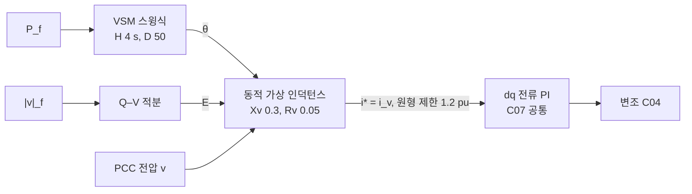

# C09. GFM — 위상을 만들기

> [!abstract] 이 강의에서 답할 질문
> [[C08-GFL-PLL로-따라가기]]의 GFL은 θ를 측정했다. 계통형성(GFM, grid-forming)은 θ를 **스스로 만든다**. 측정하지 않은 θ가 어떻게 계통과 동기를 유지하고, 같은 전류 루프 위에서 어떻게 "전압원"처럼 동작하는가?

> [!info] 학습 목표
> - 전력 동기화(power synchronization) 원리와 동기화 토크를 $P \approx (EV/X)\sin\delta$로 설명할 수 있다.
> - VSM 스윙 방정식의 $H$, $D$가 무엇을 정하는지, VSM과 P–f 드룹이 왜 등가인지 설명할 수 있다.
> - 동적 가상 인덕턴스가 내부 기전력을 전류 지령으로 바꾸어 공통 전류 루프([[C07-전류-제어]])에 넘기는 과정을 따라갈 수 있다.
> - 위상 점프 응답을 페이저 식으로 추정하고, 모델 결과(10 ms 안에 약 +0.6 pu)와 비교할 수 있다.
> - "펌웨어만 바꾸면 GFM인가?"에 하드웨어 근거를 들어 답할 수 있다.

## 1. 핵심 개념

### 1.1 θ를 만든다: 전력 동기화

GFM은 내부 기전력 $E\angle\theta$를 만들고, 그 θ를 **유효전력 균형**으로 움직인다. 동기발전기의 회전자가 하는 일을 제어기가 대신한다.

$$
\frac{d\theta}{dt} = \omega_b\,\bigl(1 + \Delta\omega\bigr),\qquad \Delta\omega = f(P^* - P)
$$

- 계통이 더 많이 끌어가면($P > P^*$) → $\Delta\omega < 0$ → θ가 뒤처짐 → 위상차 δ 감소 → $P$ 감소.
- 반대도 마찬가지다. **음의 되먹임**이므로 PLL 없이도 계통과 같은 속도로 돈다.
- 계통 위상·주파수가 바뀌면 δ가 먼저 바뀌고, 전력은 그 순간 회로 법칙으로 바뀐다. 제어기는 그 뒤에 θ를 천천히 맞춘다.

블록 구조와 동작 모드 표는 [[01-GFM-제어구조]]에 있다.

### 1.2 전력–위상차 관계와 동기화 토크

내부 기전력 $E\angle\delta$와 계통 전압 $V\angle 0$ 사이 리액턴스가 $X$이면

$$
P \approx \frac{EV}{X}\sin\delta,\qquad
K_s = \frac{\partial P}{\partial \delta} = \frac{EV}{X}\cos\delta_0
$$

$K_s$가 **동기화 토크 계수**다. $K_s > 0$(δ < 90°)이면 위상이 앞서 나갈수록 전력이 늘어 되돌리는 힘이 생긴다. 이 모델에서 $X$는 가상 리액턴스 $X_v$ = 0.3 pu와 계통 리액턴스 $1/\text{SCR}$의 합이다(가상 인덕턴스가 PCC 전압을 기준으로 동작하므로). SCR 3에서 $X$ = 0.633 pu, P* = 0.5 pu이면 $\delta_0$ ≈ 18.5°, $K_s$ ≈ 1.50 pu/rad다.

> [!note]- 유도: $P = (EV/X)\sin\delta$
> 전류 $I = \dfrac{E e^{j\delta} - V}{jX}$, 계통측 복소전력 $S = V I^*$에서
> $$S = V\,\frac{E e^{-j\delta} - V}{-jX} = \frac{j V (E\cos\delta - jE\sin\delta - V)}{X} = \frac{EV\sin\delta}{X} + j\,\frac{EV\cos\delta - V^2}{X}$$
> 저항을 무시했으므로 송전단과 수전단의 $P$가 같다. 실제 모델에는 $R_v$ = 0.05 pu와 계통 X/R = 10의 저항이 있어 약간 어긋난다. 상세는 [[01-동기기-관성-계통강도]] §1.

### 1.3 VSM: 관성과 댐핑

모델은 가상동기기(VSM, virtual synchronous machine)의 스윙 방정식을 쓴다.

$$
2H\,\frac{d\Delta\omega}{dt} = P^* - P_f - D\,\Delta\omega,\qquad H = 4\ \text{s},\ D = 50
$$

$P_f$는 PCC 전압과 변압기 전류로 계산한 유효전력을 20 Hz로 필터한 값이다. $H$는 주파수 변화에 대한 관성, $D$는 정상상태 드룹과 스윙 감쇠를 정한다.

> [!note]- 유도: 선형화한 전력 루프 (스윙 주파수와 감쇠비)
> $\dot{\Delta\delta} = \omega_b \Delta\omega$, $\Delta P = K_s \Delta\delta$ (필터 무시)를 스윙 방정식에 넣으면
> $$2H\,\ddot{\Delta\delta} + D\,\dot{\Delta\delta} + \omega_b K_s\,\Delta\delta = 0$$
> $$\omega_n = \sqrt{\frac{\omega_b K_s}{2H}},\qquad \zeta = \frac{D}{4H\,\omega_n}$$
> SCR 3, $K_s$ = 1.50이면 $\omega_n$ ≈ 8.4 rad/s(**1.34 Hz**), ζ ≈ 0.37이다. 그림 2의 GFM 전력에 보이는 약 1.3 Hz의 느린 스윙이 이 모드다. SCR이 커지면 $K_s$가 커져 ζ가 작아진다 — [[C10-약계통과-제어-상호작용]]에서 강계통 쪽 문제로 다시 본다.

### 1.4 드룹과의 등가성

정상상태에서 $d\Delta\omega/dt = 0$이므로

$$
\Delta\omega = \frac{P^* - P}{D} = m_p\,(P^* - P),\qquad m_p = \frac{1}{D} = 0.02
$$

즉 $D$ = 50은 **P–f 드룹 2 %**와 같다. 정격 출력만큼 더 내면 주파수가 2 % 내려간 곳에서 멈춘다. 반대로 드룹 제어에 전력 측정 저역통과 필터(LPF)를 붙이면 그 필터가 관성처럼 동작한다.

> [!note]- 유도: 드룹 + LPF = VSM
> 드룹 $\Delta\omega = m_p(P^* - P_f)$, LPF $\dot P_f = \omega_c (P - P_f)$에서 $P_f$를 소거하면
> $$\frac{1}{m_p\,\omega_c}\,\dot{\Delta\omega} = P^* - P - \frac{1}{m_p}\Delta\omega$$
> VSM과 비교하면 $2H = \dfrac{1}{m_p\omega_c}$, $D = \dfrac{1}{m_p}$다. 모델 값($H$ = 4 s, $D$ = 50)은 $m_p$ = 2 %, $\omega_c = D/2H$ = 6.25 rad/s(약 1 Hz)인 드룹+LPF와 같다. 차이는 매개변수화뿐이다: VSM은 $H$와 $D$를 따로 정하고, 드룹은 $m_p$와 $\omega_c$를 정한다. 상세는 [[02-GFM-제어기법]] §1.

### 1.5 동적 가상 인덕턴스 → 전류 지령 → 공통 전류 루프

GFM 외부 루프의 출력은 전압 $E\angle\theta$다. 그런데 [[C07-전류-제어]]의 내부 루프는 **전류 지령**을 받는다. 둘 사이를 잇는 것이 동적 가상 인덕턴스(가상 어드미턴스)다. θ로 회전하는 dq 좌표에서

$$
\frac{X_v}{\omega_b}\,\frac{di_v}{dt} = E - v - R_v\,i_v - j\,\omega X_v\,i_v,\qquad
X_v = 0.3,\ R_v = 0.05\ \text{pu}
$$

$v$는 PCC 전압(θ 좌표), $i_v$가 그대로 전류 지령 $i^*$가 된다. 계산 속의 가상 인덕터에 흐를 전류를 실제 컨버터가 흘리게 하는 것이다. 그래서 계통에서 보면 GFM은 **"가상 임피던스 $R_v + jX_v$ 뒤의 전압원 $E\angle\theta$"** 다.



> [!note]- 유도: αβ의 인덕터 식을 θ 좌표로
> 정지 좌표에서 가상 인덕터: $\dfrac{X_v}{\omega_b}\dfrac{di_{\alpha\beta}}{dt} = e_{\alpha\beta} - v_{\alpha\beta} - R_v i_{\alpha\beta}$.
> $i_{\alpha\beta} = i\,e^{j\theta}$, $\dot\theta = \omega_b\omega$를 대입하면
> $$\frac{X_v}{\omega_b}\left(\frac{di}{dt} + j\omega_b\omega\, i\right)e^{j\theta} = (E - v - R_v i)\,e^{j\theta}$$
> 양변의 $e^{j\theta}$를 지우면 본문 식이 된다. $-j\omega X_v i$는 회전좌표에서 생기는 교차 결합 항이다.
> 대수식 $i = (E - v)/(R_v + jX_v)$(정적 가상 임피던스) 대신 미분식을 쓰면, 가상 인덕터가 실제 인덕터처럼 고주파 전압 변동을 걸러 준다. 대신 시정수 $X_v/(\omega_b R_v)$ ≈ 16 ms의 전자기 과도(동기기의 직류 옵셋에 해당)가 생긴다.

전류 제한은 $|i_v|$를 1.2 pu에서 원형 포화시키고, 한계 밖으로 커지는 성분의 적분을 막는다(anti-windup). 제한 중에는 VSM 가속을 멈춰 위상 이탈을 줄인다. 이 부분은 [[C11-전류-제한과-고장]]에서 다룬다.

### 1.6 Q–V: 내부 기전력 E 만들기

내부 기전력 크기 $E$는 PCC 전압을 1 pu로 맞추는 적분 제어로 만든다(모델 이득 5 pu/s/pu, $E$ = 1 ± 0.3 pu).

$$
E = 1 + \int k_E\,\bigl(V^* - |v|_f\bigr)\,dt
$$

GFL의 전압 제어([[C08-GFL-PLL로-따라가기]] §1.5)는 Q **지령**을 만들었지만, GFM은 전압원의 **크기**를 직접 정한다. 빠른 전압 지지는 적분기가 아니라 $E - v$ 차이에서 즉시 나온다. 적분기는 정상상태 전압만 맞춘다.

### 1.7 측정점

| 신호 | 측정 | 쓰는 곳 |
|---|---|---|
| PCC 전압 $v$ (변압기 고압측) | 순시값(평균값 모델) / 10 kHz 샘플(스위칭 모델) | 가상 인덕턴스 입력 |
| $P_f$, $\lvert v\rvert_f$ | PCC 전압 × 변압기 전류, 20 Hz 필터 | VSM 스윙식, Q–V |
| 컨버터측 전류 | Lf 전류 | 전류 루프·전류 제한만 |

GFM도 측정을 한다. 차이는 **위상 θ를 측정하지 않는다**는 것, 그리고 외란 직후의 응답이 측정 필터를 기다리지 않고 $E - v$ 차이에서 바로 나온다는 것이다. 측정점 선정 이유는 [[C05-필터-변압기-측정점]]에 있다.

### 1.8 GFM 기법 비교

이 강좌 모델은 VSM이지만, 다른 기법들도 "전력 동기화 루프"의 모양만 다르다. 상세 수식과 장단점은 [[02-GFM-제어기법]]에 있다.

| 기법 | 위상 생성 (요지) | 관성 | 특징 |
|---|---|---|---|
| P–f 드룹 | $\omega = 1 + m_p(P^* - P_f)$ | LPF가 간접 제공 | 단순, 병렬운전에 오래 쓰임 |
| VSM / VSG | $2H\dot{\Delta\omega} = P^* - P - D\Delta\omega$ | $H$로 명시 | $H$, $D$를 따로 설정, 계통코드 대응 쉬움 |
| dVOC | 비선형 진동자 동역학 | 암묵적 | 대신호 안정성 증명, 상용 초기 |
| PSC | $\dot\theta = \omega_b[1 + k_p(P^* - P)]$ + 고장 시 PLL 전환 | 작음 | HVDC 약계통 연계에서 출발 |
| Matching | $\dot\theta \propto v_{dc}$ | DC 커패시터 | 하드웨어 에너지와 일관, DC 전압 변동 필요 |

### 1.9 위상 점프: 측정 없는 응답

계통 위상이 −20° 뛰면 δ가 즉시 +20° 커진다. 페이저 식으로 추정하면

$$
\Delta P \approx \frac{EV}{X}\bigl[\sin(\delta_0 + 20°) - \sin\delta_0\bigr] \approx 0.48\ \text{pu}\quad(\text{SCR 3, }P_0 = 0.5)
$$

모델에서는 GFM이 **10 ms 안에 약 +0.6 pu**(최대 +0.64 pu, 10~30 ms 평균 +0.50 pu)로 응답하고, GFL은 거의 0이다(+0.007 pu). 최대값이 페이저 추정보다 큰 것은 1.5절의 전자기 과도(약 16~20 ms 시정수의 60~80 Hz 감쇠 진동) 때문이다. 이후 1.3 Hz의 VSM 스윙을 거쳐 원래 출력으로 돌아온다. 이 응답이 계통코드가 말하는 위상 점프 전력(phase jump power)이다([[04-GFM-핵심기능]] §3).

> [!question] FAQ: 펌웨어만 바꾸면 GFM이 되나?
> 제어 알고리즘(이 강의의 외부 루프)은 소프트웨어다. 그러나 GFM이 **약속하는 응답**을 실제로 내려면 하드웨어가 받쳐 줘야 한다([[03-FAQ]] Q1).
> - **전압 여유** ([[C04-변조-SPWM-SVPWM]]): 전류를 지령 대신 회로가 정하는 순간 응답을 내려면 컨버터 출력 전압에 여유가 있어야 한다. 최대 출력 1.302 pu에서 필터·변압기 전압강하를 빼고도 $E$를 키울 여유가 남아야 한다. 변조 한계에 붙으면 전압원 특성이 사라진다.
> - **과부하 정격**: 위의 위상 점프에서 전력은 0.5 → 약 1.1 pu로 올랐다. 운전점이 0.8 pu였다면 같은 점프에 전류 한계 1.2 pu에 닿는다. 관성·위상 점프 응답에는 수 초 단위의 과부하 여유(문헌상 1.2~1.5 pu)와 그에 맞는 열 설계가 필요하다.
> - **전류 제한 중 동기 유지** ([[C11-전류-제한과-고장]]): 전류가 포화되면 전압원이 전류원이 되어 동기화 토크가 사라진다. 이 모델도 제한 중 VSM 가속을 멈추는 보정이 없으면 고장 중 위상 이탈이 커졌다. 이것은 제어 문제이지만, 검증(시험)은 하드웨어와 함께 다시 해야 한다.
> - **에너지 버퍼**: 상향 응답에는 즉시 꺼낼 에너지가 필요하다. ESS는 유리하고, PV 단독은 출력 여유가 있어야 한다.
>
> 결론: 하드웨어가 이 조건을 만족하면 펌웨어 전환이 가능하다(사례는 [[03-FAQ]] Q1). 아니라면 "GFM 알고리즘을 얹은 GFL 하드웨어"가 되어, 정작 필요한 순간에 한계에 걸린다.

## 2. 그림으로 보기

그림 스크립트: `docs/_assets/강좌/scripts/C09_figs.py` (저장소 루트에서 실행)

**그림 1. 전력–위상차 곡선과 위상 점프 전력**

![[C09-P-델타-곡선.png]]

E = V = 1 pu, $X = X_v + 1/\text{SCR}$ = 0.633 pu(SCR 3). 운전점 δ₀ = 18.5°에서 계통 위상이 −20° 뛰면 δ가 38.5°로 커지고, 곡선을 따라 ΔP ≈ 0.48 pu가 **측정 없이** 생긴다. $P_{max}$ = 1/0.633 ≈ 1.58 pu, 곡선의 기울기가 동기화 토크 계수 $K_s$다.

**그림 2. 위상 점프 −20°: GFM과 GFL**

![[C09-위상점프-GFM-GFL.png]]

평균값 EMT 모델, SCR 3, P* = 0.5 pu. 왼쪽: GFM은 음영(처음 10 ms) 안에서 최대 약 1.13 pu까지 오르고, 16~20 ms 시정수의 전자기 과도와 1.3 Hz VSM 스윙을 거쳐 0.5 pu로 돌아온다. GFL은 0.5 pu 근처에 머문다. 오른쪽: GFM의 내부 주파수는 59.7 Hz까지 천천히 내려갔다 돌아오고(관성), GFL의 PLL 측정 주파수는 54 Hz 한계에 붙는다.

## 3. Python 실습

평균값 모델(`converter="average"`, 해석 간격 10 µs)을 쓴다. 저장소 루트에서 실행한다.

**실습 1. 위상 점프 −20°: GFM vs GFL, 페이저 근사와 비교**

```python
# 저장소 루트에서 실행 (약 20 s): 위상 점프 −20°, GFM vs GFL
import sys, math; sys.path.insert(0, "simulation/emt")
import numpy as np
from gfm_gfl_emt import Params, Scenario, simulate, steady_state

DT = 10e-6
p = Params(converter="average")               # SCR 3, P* = 0.5 pu, H 4 s, D 50, Xv 0.3, Rv 0.05
jump = Scenario(t_end=0.3, grid_phase=lambda t: math.radians(-20) if t >= 0.1 else 0.0)

for mode in ("GFM", "GFL"):
    r = simulate(mode, p, jump, dt=DT, x0=steady_state(mode, p, dt=DT))
    t, P = np.asarray(r["t"]), np.asarray(r["P"])
    P0 = P[t < 0.1][-1]
    m10 = (t >= 0.1) & (t <= 0.11)
    print(f"{mode}: 10 ms 내 최대 ΔP {P[m10].max() - P0:+.3f} pu, "
          f"10~30 ms 평균 ΔP {P[(t > 0.11) & (t < 0.13)].mean() - P0:+.3f} pu")

# 페이저 근사: X = Xv + 1/SCR
X = p.Xv + 1 / p.scr
d0 = math.asin(p.P_ref * X)
print(f"페이저 근사 ΔP = {(math.sin(d0 + math.radians(20)) - math.sin(d0)) / X:+.3f} pu")
```

```
GFM: 10 ms 내 최대 ΔP +0.636 pu, 10~30 ms 평균 ΔP +0.498 pu
GFL: 10 ms 내 최대 ΔP +0.007 pu, 10~30 ms 평균 ΔP +0.007 pu
페이저 근사 ΔP = +0.482 pu
```

**실습 2. VSM의 정상상태 = 드룹 2 %**

```python
# 저장소 루트에서 실행 (약 10 s): 계통 주파수 −0.2 Hz 계단 → VSM 정상상태 = 드룹 2 %
import sys; sys.path.insert(0, "simulation/emt")
import numpy as np
from gfm_gfl_emt import Params, Scenario, simulate, steady_state

DT = 10e-6
p = Params(converter="average")
step = Scenario(t_end=2.0, grid_f=lambda t: 1.0 - 0.2 / 60 if t >= 0.1 else 1.0)
r = simulate("GFM", p, step, dt=DT, x0=steady_state("GFM", p, dt=DT))
t, P = np.asarray(r["t"]), np.asarray(r["P"])
dP = P[t > 1.8].mean() - P[t < 0.1][-1]
print(f"모델 ΔP = {dP:+.3f} pu,  드룹 예측 D·Δf/f0 = {p.D * 0.2 / 60:+.3f} pu")
print(f"최대 ΔP = {P.max() - P[t < 0.1][-1]:+.3f} pu (관성 모드 오버슈트)")
```

```
모델 ΔP = +0.169 pu,  드룹 예측 D·Δf/f0 = +0.167 pu
최대 ΔP = +0.287 pu (관성 모드 오버슈트)
```

> [!tip] 해볼 것
> - 실습 1에서 `Params(converter="average", Xv=0.15)`로 가상 리액턴스를 줄이면 페이저 식으로는 ΔP가 0.66 pu로 커져야 한다. 그런데 모델의 10 ms 최대 ΔP는 오히려 약 0.51 pu로 줄어든다. `r["sat"]`를 보면 전류가 1.2 pu 한계에 걸렸기 때문이다. 가상 리액턴스를 줄여 "더 강한" 전압원을 만들어도 과부하 정격이 먼저 막는다.
> - 실습 2에서 `H=1.0`과 `H=8.0`을 비교한다. 정상상태 ΔP는 같고(드룹), 오버슈트와 스윙 주파수가 달라진다. 1.3절의 $\omega_n$, ζ 식으로 설명해 본다.
> - 실습 1에서 `P_ref=0.8`로 바꾸면 점프 약 2.5 ms 뒤부터 0.3 s 넘게 전류 한계에 걸린다(`r["sat"]`). 이때 위상 점프 전력이 어떻게 잘리는지는 [[C11-전류-제한과-고장]]에서 다룬다.

## 4. 흔한 오해

> [!warning] 오해: GFM은 아무것도 측정하지 않는다
> GFM도 PCC 전압과 전력을 측정한다. 측정하지 않는 것은 **계통 위상**이다. 그리고 외란 직후의 전력 변화는 측정 필터를 거치지 않고 $E - v$ 차이에서 바로 나온다. 측정값(P_f)은 θ를 천천히 다시 맞추는 데 쓰인다.

> [!warning] 오해: VSM과 드룹은 전혀 다른 제어다
> 드룹 + 전력 LPF는 $2H = 1/(m_p\omega_c)$, $D = 1/m_p$인 VSM과 수학적으로 같다. 차이는 어떤 매개변수를 직접 정하느냐다.

> [!warning] 오해: GFM이면 전압 루프와 전류 루프가 모두 따로 있어야 한다
> 이 모델은 전압 루프 없이 **동적 가상 인덕턴스 → 전류 지령 → 공통 전류 루프**로 전압원 특성을 만든다. GFL과 같은 전류 루프를 그대로 쓰므로 전류 제한도 같은 자리에서 한다. 캐스케이드 전압·전류 루프는 여러 구현 중 하나다([[01-GFM-제어구조]] §2.3).

## 5. 확인 문제

1. SCR 5, $X_v$ = 0.3 pu, $E = V$ = 1 pu, $P_0$ = 0.5 pu에서 계통 위상이 −10° 뛰면 위상 점프 전력은 페이저 근사로 얼마인가?

> [!success]- 답
> $X = 0.3 + 1/5 = 0.5$ pu, $\delta_0 = \arcsin(0.5 \times 0.5)$ ≈ 14.5°.
> $\Delta P \approx [\sin 24.5° - \sin 14.5°]/0.5 = (0.414 - 0.250)/0.5$ ≈ **0.33 pu**. 실제 순간 최대값은 전자기 과도 때문에 이보다 조금 크다.

2. $H$ = 4 s, $D$ = 50인 VSM이 계통 주파수 0.3 Hz 하락을 겪으면 정상상태 ΔP는 얼마인가? 같은 동특성을 드룹 + LPF로 만들려면 $m_p$와 필터 차단주파수는?

> [!success]- 답
> 정상상태 $\Delta P = D\cdot\Delta f/f_0 = 50 \times 0.3/60$ = **0.25 pu** 증가.
> $m_p = 1/D$ = 2 %, $\omega_c = D/(2H) = 50/8$ = 6.25 rad/s ≈ **1.0 Hz**.

3. GFM의 위상 점프 응답이 "측정 기반이 아니다"라는 말은 GFM이 $P$를 측정한다는 사실과 어떻게 양립하는가? 동적 가상 인덕턴스 식으로 설명하라.

> [!success]- 답
> 위상 점프 순간 PCC 전압 $v$(θ 좌표)가 바뀌면 $\frac{X_v}{\omega_b}\frac{di_v}{dt} = E - v - \dots$의 우변이 즉시 바뀌어 전류 지령 $i_v$가 회로처럼 변한다. θ와 $E$는 그 순간 그대로다. 측정한 $P_f$는 스윙 방정식에 들어가 θ를 수백 ms에 걸쳐 다시 맞추는 데만 쓰인다. 즉 **첫 응답**은 측정 필터를 기다리지 않는다. GFL은 반대로 PLL이 θ를 바꾸고, 그 다음 지령이 바뀌어야 전력이 움직인다.

## 연결

- 이전: [[C08-GFL-PLL로-따라가기]] · 다음: [[C10-약계통과-제어-상호작용]]
- 이어서: [[C11-전류-제한과-고장]] (전류 제한 중 동기 유지), [[C12-표준-시험으로-비교]] (위상 점프 시험)
- 더 보기: [[01-GFM-제어구조]] · [[02-GFM-제어기법]] · [[04-GFM-핵심기능]] · [[03-FAQ]] · [[01-GFM-vs-GFL-비교표]] · [[simulation/emt/README|EMT 시뮬레이션]]
- 목차: [[00-강좌-목차]]
