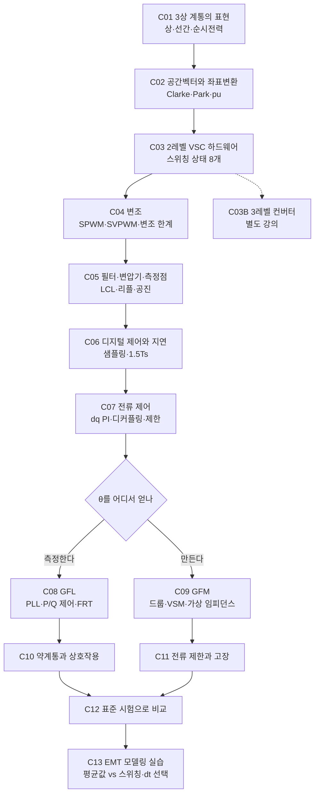

# 3상 컨버터부터 GFM·GFL까지 설명 계획

> [!abstract] 목표
> 3상 전압형 컨버터(VSC)가 **스위치 여섯 개로 어떻게 교류를 만드는지**에서 출발해, 같은 하드웨어가 제어만으로 **계통추종(GFL)** 과 **계통형성(GFM)** 으로 갈리는 지점까지 한 흐름으로 설명한다. 각 단계는 지식창고의 기존 문서와 [[simulation/emt/README|EMT 시뮬레이션]]에 연결해, 읽고 바로 돌려볼 수 있게 한다.

> [!info] 대상 독자와 전제
> - **대상**: 전력계통 또는 전력전자 중 한쪽 배경을 가진 엔지니어, ESS·재생에너지 사업 기술 담당자.
> - **전제 지식**: 교류 회로(페이저, 임피던스), 기초 제어(PI, 전달함수). 이 둘이 없으면 C00 부록부터 읽는다.
> - **기준 설비**: 시뮬레이션과 같은 값으로 통일하고 **모든 전기량은 pu로만** 쓴다. $V_{dc}$ = 2.256 pu, 2레벨 VSC, 스위칭 5 kHz, $L_f$ 0.2 pu, 해석 간격 2 µs.
> - **표기**: 수식 유도는 접는 콜아웃(`> [!note]- 유도: …`)에 숨기고, 실습은 Python만 쓴다.

---

## 1. 전체 흐름

> [!tip] 핵심 메시지 하나
> C01~C07은 GFL과 GFM이 **완전히 공유**하는 부분이다. 갈림길은 C07의 전류 지령을 만드는 외부 루프, 정확히는 **위상 θ를 측정하느냐(PLL) 만들어내느냐(스윙 방정식)** 하나다. 강좌 전체를 이 갈림길을 향해 설계한다.

---

## 2. 강의별 계획

각 강의는 같은 틀로 쓴다: **학습 목표 → 핵심 개념 → 수식 → 그림 → 실습 → 연결 문서 → 흔한 오해**. 분량은 A4 기준 쪽수 추정이다.

### Part A. 3상과 컨버터의 언어

#### C01. 3상 계통의 표현
- **학습 목표**: 상전압과 선간전압, 실효값과 진폭, 3상 순시전력이 왜 일정한지 설명할 수 있다.
- **핵심 개념**: 평형 3상, 상순, 상전압 진폭 1 pu일 때 선간 진폭 $\sqrt3$ pu·상 실효값 $1/\sqrt2$ pu, 3상 순시전력 $p(t)=v_a i_a+v_b i_b+v_c i_c$ 의 맥동 상쇄.
- **그림**: 3상 파형과 순시전력 합, 상·선간 페이저도.
- **실습**: 시뮬레이션 기록값 `va, vb, vc, ia, ib, ic` 로 순시전력을 직접 계산해 P와 비교.
- **연결**: [[02-인버터-기본구조-제어계층]]
- **분량**: 4쪽

#### C02. 공간벡터, 좌표변환, pu
- **학습 목표**: 3상 신호를 복소수 하나로 쓰는 이유와 dq 좌표에서 정현파가 직류가 되는 원리를 설명할 수 있다.
- **핵심 개념**: 진폭 불변 Clarke 변환 $\vec v=\tfrac23(v_a+v_b e^{j2\pi/3}+v_c e^{-j2\pi/3})$, Park 변환 $v_{dq}=\vec v\,e^{-j\theta}$, $P=\mathrm{Re}(v\,i^*)$, $Q=\mathrm{Im}(v\,i^*)$, 영상분의 의미, pu 기준값 설정.
- **그림**: αβ 평면에서 회전하는 벡터, dq 축 정렬 애니메이션(정지 그림 3장).
- **실습**: `gfm_gfl_emt.py` 의 복소 공간벡터 표현을 읽고, 임의 θ로 dq 변환해 보기.
- **연결**: [[02-인버터-기본구조-제어계층]]
- **분량**: 5쪽
- **흔한 오해**: "dq 변환은 GFM/GFL 전용 기법" → 3상 제어 전반의 공통 도구다.

### Part B. 3상 전압형 컨버터 하드웨어

#### C03. 2레벨 VSC: 스위치 여섯 개로 교류 만들기
- **학습 목표**: 스위칭 상태 8개(유효 6, 영 2)가 만드는 전압 벡터와 극전압·상전압의 관계를 설명할 수 있다.
- **핵심 개념**: 레그당 상·하 스위치 상보 동작, 극전압 $\pm V_{dc}/2 = \pm 1.128$ pu, 중성점 전위와 영상분 제거, 데드타임(개념만). 3레벨은 [[C03B-3레벨-컨버터|C03B]]로 분리.
- **그림**: 6개 유효 벡터 육각형, 상태별 회로도.
- **실습**: 모델의 `pwm()` 이 스위치 상태에서 αβ 전압을 만드는 코드 추적.
- **연결**: [[02-인버터-기본구조-제어계층]], [[01-GFM-GFL이란]]
- **분량**: 6쪽

#### C03B. 3레벨 컨버터 (별도 강의)
- **학습 목표**: NPC 3레벨 구조와 27개 스위칭 상태, 중성점 전위 균형 원리를 설명할 수 있다.
- **핵심 개념**: 레그당 +·0·− 세 상태, 극전압 $+V_{dc}/2$·0·$-V_{dc}/2$, 대·중·소·영 벡터와 중복 소벡터, 출력 계단 수 증가에 따른 고조파·필터 부담 감소(정성), 중성점 전위 균형, 변조 한계는 2레벨과 같음.
- **실습**: Python으로 27개 상태의 αβ 벡터 계산·그리기.
- **분량**: 5쪽

#### C04. 변조: SPWM, SVPWM, 변조 한계
- **학습 목표**: $V_{dc}$ = 2.256 pu로 낼 수 있는 최대 교류 전압을 계산하고, 영상분 주입이 왜 15 % 이득을 주는지 설명할 수 있다.
- **핵심 개념**:
  - 삼각파 비교 PWM, 변조지수.
  - 최대 상전압 진폭: SPWM $V_{dc}/2$ = 1.128 pu, SVPWM·min-max 주입 $V_{dc}/\sqrt3$ = **1.302 pu**.
  - 과변조, 스위칭 고조파의 위치($f_{sw}$, $2f_{sw}$ 측파대).
  - 전압 여유의 의미: 1.302 pu는 무효전력 공급·필터 전압강하·과도 응답에 쓸 수 있는 전부다.
- **그림**: 변조파·반송파·극전압 파형, 영상분 주입 전후 변조파 비교.
- **실습**: `Params(modulation="spwm")` 과 기본값(SVPWM)으로 고장 시나리오를 돌려 전압 포화 차이 관찰.
- **분량**: 6쪽
- **흔한 오해**: "DC 전압만 충분하면 GFM 성능은 무관" → 위상점프·고장 응답은 전압 여유를 소모한다.

#### C05. 필터, 변압기, 그리고 측정점
- **학습 목표**: Lf 크기와 스위칭 주파수로 전류 리플을 추정하고, 전력 측정을 어디서 해야 하는지 판단할 수 있다.
- **핵심 개념**:
  - L 필터와 LCL 필터, 공진 주파수 $f_{res}=f_0\sqrt{(L_f+L_g)/(L_f L_g C_f)}$, 수동 댐핑 저항.
  - 리플 상한(단상 하프브리지 기준) $\Delta i_{pp}\approx V_{dc}/(4L_f f_{sw})$. 우리 모델(Lf 0.2 pu, 5 kHz)의 실측 리플은 약 0.11 pu 피크-피크.
  - **측정점 설계**: 컨버터측(Lf) 전류는 리플이 커서 전류 제어·제한용, 전력·전압·위상은 변압기 전류와 PCC 전압으로 측정.
- **그림**: LCL 회로와 주파수 응답, 측정점 위치도.
- **실습**: [[simulation/emt/README|EMT 시뮬레이션]]의 `hires` 기록으로 Lf 전류와 변압기 전류 리플 비교.
- **연결**: [[02-인버터-기본구조-제어계층]]
- **분량**: 6쪽

> [!example] 이 강좌가 담을 실제 사례
> 우리 시뮬레이션은 처음에 Lf 전류와 필터 단자 전압으로 전력을 쟀다. 그 결과 360·720·1080 Hz 에일리어싱 잡음(표준편차 약 0.010 pu)이 섞여, 강계통의 GFM이 '불안정'으로 잘못 판정되었다. 변압기 전류·PCC 전압으로 옮기자 잡음이 약 0.004 pu로 줄었다. C05의 핵심 사례로 쓴다.

### Part C. 디지털 제어와 전류 제어

#### C06. 디지털 제어와 지연
- **학습 목표**: 샘플링, 계산 지연, PWM 갱신이 만드는 1.5 샘플 지연을 설명하고 제어 대역폭 한계를 추정할 수 있다.
- **핵심 개념**: 반송파 꼭짓점 동기 샘플링(리플 평균값 획득), 2회 갱신(5 kHz 스위칭 → 10 kHz 샘플링), 1샘플 계산 지연, 총 지연 약 150 µs, 위상 지연 $\omega T_d$.
- **그림**: 반송파·샘플 시점·지령 적용 시점 타이밍도.
- **실습**: 평균값 모델(1차 지연 근사)과 스위칭 모델(실제 샘플-홀드)의 위상 점프 응답 비교.
- **분량**: 4쪽

#### C07. 전류 제어
- **학습 목표**: dq 전류 PI 제어기를 설계하고, 전압 피드포워드와 지연이 약계통 안정도에 미치는 영향을 설명할 수 있다.
- **핵심 개념**: $K_p=\omega_{cc}L_f/\omega_b$, 교차결합 디커플링 $j\omega L_f i$, 전압 피드포워드의 장단점, 전압 포화와 anti-windup, 원형 전류 제한과 P/Q 우선순위.
- **그림**: 전류 제어 블록도, 대역폭 800 Hz 계단 응답.
- **실습**: `ff_gain=1` 과 `0` 으로 SCR 2 이하에서 비교 (모델링 교훈 1).
- **연결**: [[01-GFL-제어구조]], [[03-전류제한-고장대응]]
- **분량**: 6쪽
- **흔한 오해**: "약계통 불안정은 언제나 PLL 탓" → 지연이 있는 상태의 전압 피드포워드도 공통 원인이다.

### Part D. 갈림길: θ를 측정하느냐, 만드느냐

#### C08. GFL: PLL로 계통을 따라가기
- **학습 목표**: SRF-PLL의 동작과 대역폭 설계, P/Q → 전류 지령 변환, FRT 로직을 설명할 수 있다.
- **핵심 개념**: $v_q\to0$ 이 되도록 θ 추종, PLL 대역폭 10~50 Hz의 트레이드오프, 전류원 등가, FRT 무효전류 주입과 모드 순환 문제.
- **그림**: PLL 루프, GFL 전체 블록도.
- **실습**: PLL 10·35·50 Hz로 SCR 스윕(안정도 맵), 위상 점프 시 PLL 주파수 급변 관찰.
- **연결**: [[01-GFL-제어구조]], [[02-GFL-한계-약계통]]
- **분량**: 6쪽

#### C09. GFM: 위상을 스스로 만들기
- **학습 목표**: 드룹·VSM이 유효전력 균형으로 θ를 만드는 원리와, 가상 임피던스가 전압원 거동을 만드는 방식을 설명할 수 있다.
- **핵심 개념**: $2H\dot{\Delta\omega}=P^*-P-D\Delta\omega$, $P\approx\frac{EV}{X}\sin\delta$, 동기화 토크, 동적 가상 인덕턴스 $(X_v/\omega_b)\dot i=E-v-R_v i-j\omega X_v i$, Q–V 제어, 드룹·VSM·dVOC·PSC 비교.
- **그림**: GFM 블록도, 전압원-임피던스 등가회로, P–δ 곡선.
- **실습**: 위상 점프 −20°에서 GFM의 10 ms 내 전력 응답 관찰, H·Xv 변경 실험.
- **연결**: [[01-GFM-제어구조]], [[02-GFM-제어기법]], [[04-GFM-핵심기능]]
- **분량**: 8쪽

> [!question] 강의 중 던질 질문
> 같은 PCS에 펌웨어만 바꾸면 GFM이 되는가? 답의 근거는 C04(전압 여유), C05(과부하 정격), C11(전류 제한 중 동기 유지)에 있다. [[03-FAQ]] Q1과 연결한다.

### Part E. 계통 속에서의 거동

#### C10. 약계통과 제어 상호작용
- **학습 목표**: SCR과 계통강도, GFL의 PLL 상호작용, GFM이 약계통에서 유리한 이유를 설명할 수 있다.
- **핵심 개념**: SCR·WSCR, 음저항 개념, 진동 유형(10 Hz 동기화 상실형, 75~115 Hz 상호작용형), GFM의 강계통 과제.
- **실습**: 안정도 맵 재현, 진동 주파수 스펙트럼 분석.
- **연결**: [[01-동기기-관성-계통강도]], [[02-GFL-한계-약계통]], [[02-하이브리드-혼합계통]]
- **분량**: 5쪽

#### C11. 전류 제한과 고장
- **학습 목표**: 전압원인 GFM이 고장 시 전류를 어떻게 제한하고, 제한 중 동기를 어떻게 유지하는지 설명할 수 있다.
- **핵심 개념**: 원형 포화, 가상 임피던스 증대, 제한 중 VSM 가속 억제, 고장 후 재동기, 한국 연계기준안 2.0 pu·140 ms의 하드웨어 의미.
- **실습**: 보정 유무(`gfm_limit_freeze`) 비교, I_max 1.2 / 2.0 pu PCC 고장 비교.
- **연결**: [[03-전류제한-고장대응]], [[02-한국-제도-요건]]
- **분량**: 6쪽

#### C12. 표준 시험으로 비교하기
- **학습 목표**: NERC·AEMO·ERCOT·ENTSO-E·GB 시험 항목의 의도와 판정 지표를 설명하고, 시험 결과를 읽을 수 있다.
- **핵심 개념**: 최후 동기기 상실, RoCoF, SCR 급감+고장, 위상각 스텝(15 ms·10 ms·5 ms 기준), 전압 스텝(30 ms), 감쇠비 5 %, 고장전류.
- **실습**: `compliance_tests.py` 실행, [[reports/gfm-gfl-test-report.html|시험 결과 보고서]] 해석.
- **연결**: [[01-국제표준-해외계통코드]], [[01-시험-검증-방법]]
- **분량**: 6쪽

### Part F. 실습

#### C13. EMT 모델링 실습
- **학습 목표**: 평균값 모델과 스위칭 모델의 차이, 해석 시간 간격 선택, 수렴 확인 방법을 설명할 수 있다.
- **핵심 개념**: 공간벡터 상태방정식, RK4, 스위칭 시점 양자화(2 µs = 반송파 주기 1 %), 기록 간격과 에일리어싱, 정상상태 웜스타트와 캐시, 수렴표 읽기.
- **실습**: `convergence.py` 로 10·5·2·1 µs 비교, 회귀 테스트 작성.
- **연결**: [[simulation/emt/README|EMT 시뮬레이션]]
- **분량**: 5쪽

#### C00. 부록: 선수 지식 요약
- 페이저와 임피던스, PI 제어기와 대역폭, 라플라스 변환 1쪽 요약. **분량**: 3쪽

---

## 3. 산출물과 파일 배치

> [!note] 폴더 규칙
> 강의 노트는 `docs/09-강좌-3상컨버터에서-GFM까지/` 에 `C01-3상-계통의-표현.md` 형식으로 둔다. 목차는 [[00-강좌-목차]], 템플릿은 `templates/강의-템플릿.md`. 기존 문서와 겹치는 설명은 새로 쓰지 않고 위키링크로 연결한다. 그림은 `docs/_assets/강좌/` 에, 그림 생성 스크립트는 `docs/_assets/강좌/scripts/` 에 둔다.

| 강의 | 새로 쓸 분량 | 기존 문서 재사용 | 시뮬레이션 실습 | 우선순위 |
|---|---|---|---|---|
| C01 3상 표현 | 대부분 신규 | 일부 | 순시전력 계산 | 2 |
| C02 공간벡터 | 대부분 신규 | 좌표변환 절 | dq 변환 | 1 |
| C03 2레벨 VSC | 전부 신규 | — | `pwm()` 추적 | 1 |
| C03B 3레벨 (별도) | 전부 신규 | — | 27개 벡터 그리기 | 2 |
| C04 변조 | 전부 신규 | — | SPWM vs SVPWM | 1 |
| C05 필터·측정점 | 대부분 신규 | 하드웨어 절 | 리플·측정점 비교 | 1 |
| C06 디지털 제어 | 전부 신규 | — | 평균값 vs 스위칭 | 2 |
| C07 전류 제어 | 절반 | 전류 루프 절 | 피드포워드 비교 | 1 |
| C08 GFL | 보강 | GFL 문서 2편 | PLL 대역폭 맵 | 2 |
| C09 GFM | 보강 | GFM 문서 4편 | 위상 점프·H 변경 | 1 |
| C10 약계통 | 보강 | 기초이론·한계 | 안정도 맵 | 3 |
| C11 전류 제한 | 보강 | 전류제한 문서 | 보정·정격 비교 | 2 |
| C12 표준 시험 | 요약 | 표준 문서 2편 | 시험 보고서 | 3 |
| C13 EMT 실습 | 절반 | 시뮬레이션 README | 수렴 확인 | 3 |

---

## 4. 작업 체크리스트

### 준비
- [x] 강의 노트 템플릿 만들기 (`templates/강의-템플릿.md`)
- [x] `docs/09-강좌-3상컨버터에서-GFM까지/` 와 목차 노트 [[00-강좌-목차]]
- [x] 기호·단위 확정: pu만, 진폭 불변 변환, $\omega_b = 2\pi\cdot60$, 유도는 접는 콜아웃

### 초안 작성 (5개 묶음 병렬)
- [ ] C00·C01·C02
- [ ] C03·C03B·C04
- [ ] C05·C06·C07
- [ ] C08·C09·C10
- [ ] C11·C12·C13

### 1차: 하드웨어와 변조 (우선순위 1)
- [ ] C02 공간벡터 — 그림 3장
- [ ] C03 2레벨 VSC — 스위칭 상태 육각형
- [ ] C04 변조 — V_dc 2.256 pu 변조 한계 계산 예제, SPWM vs SVPWM 실습
- [ ] C05 필터·측정점 — 측정점 사례 포함
- [ ] C07 전류 제어 — 피드포워드 실습

### 2차: 갈림길 (우선순위 1~2)
- [ ] C09 GFM — 위상 점프 실습
- [ ] C08 GFL — PLL 대역폭 실습
- [ ] C06 디지털 제어 — 타이밍도
- [ ] C11 전류 제한 — 보정·정격 비교
- [ ] C01 3상 표현

### 3차: 계통 거동과 실습 (우선순위 3)
- [ ] C10 약계통
- [ ] C12 표준 시험 (2 µs 시험 결과 확정 후)
- [ ] C13 EMT 실습
- [ ] C00 부록

### 마무리
- [ ] 강의별 슬라이드 묶음을 [[slides/README|HTML 슬라이드]]에 장 추가
- [ ] 용어 신규분을 [[01-용어집]]에 추가
- [ ] 각 강의 끝 확인 문제 3개 작성

---

## 5. 결정 사항 (2026-11-01)

> [!check] 확정
> - **수식 유도**: 본문에는 결론 식만 두고, 유도는 접는 콜아웃 `> [!note]- 유도: …` 으로 숨긴다.
> - **3레벨 컨버터**: 별도 강의 [[C03B-3레벨-컨버터|C03B]]로 뺀다.
> - **손실·소자·스위칭 주파수 비교**: 넣지 않는다.
> - **실습 환경**: Python만 쓴다 (`simulation/emt` 모델과 numpy).
> - **단위**: 모든 전기량을 pu로만 표기한다. 주파수(Hz)와 시간(s)은 그대로 쓴다.

## 관련 노트

- [[README|지식창고 목차]]
- [[01-GFM-GFL이란]] · [[02-인버터-기본구조-제어계층]] · [[01-GFM-제어구조]] · [[01-GFL-제어구조]]
- [[simulation/emt/README|EMT 시뮬레이션]] · [[reports/gfm-gfl-test-report.html|시험 결과 보고서]] · [[slides/README|HTML 슬라이드]]
