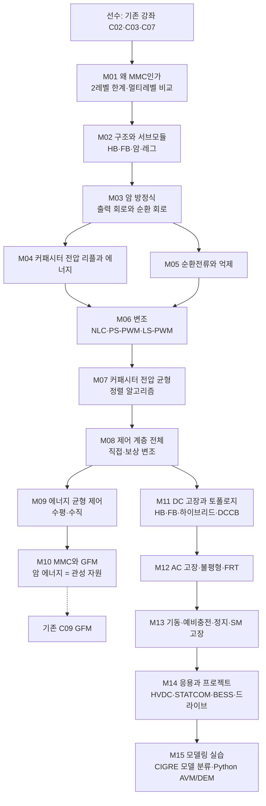

# MMC 지식창고 및 강좌 계획

> [!abstract] 목표
> **MMC(Modular Multilevel Converter, 모듈형 멀티레벨 컨버터)** 를 두 갈래로 정리한다.
> 1. **지식창고** (`docs/10-MMC/`): 구조·원리·제어·고장·응용·표준을 찾아보기 좋게 쓴 참고 문서.
> 2. **강좌** (`docs/11-강좌-MMC/`): 2레벨 VSC를 아는 사람이 "서브모듈 수백 개를 어떻게 하나의 전압원으로 움직이는가"를 한 흐름으로 배우는 15편.
>
> 기존 [[3상컨버터부터-GFM-GFL-설명계획|3상 컨버터 → GFM 강좌]]를 선수 과정으로 두고, C03(2레벨 VSC)·C07(전류 제어)·C09(GFM)에서 갈라져 나온다. MMC를 **GFM HVDC·GFM STATCOM의 하드웨어**로 보는 관점을 이 지식창고의 차별점으로 삼는다.

> [!info] 대상 독자와 전제
> - **대상**: 2레벨 VSC와 dq 전류 제어를 아는 전력전자·전력계통 엔지니어, HVDC·STATCOM·대용량 ESS 사업 기술 담당자.
> - **전제 지식**: [[C02-공간벡터-좌표변환-pu|C02]] 좌표변환, [[C03-2레벨-VSC|C03]] 2레벨 VSC, [[C07-전류-제어|C07]] dq 전류 제어. 이 셋을 모르면 기존 강좌부터 읽는다.
> - **기준 설비**: 모든 전기량은 **pu**로만 쓴다. 교육용으로 암당 서브모듈 수를 작게 잡는다 (아래 2절 표).
> - **표기**: 수식 유도는 접는 콜아웃(`> [!note]- 유도: …`), 실습은 Python만. 그림은 `docs/_assets/강좌-MMC/`, 스크립트는 그 아래 `scripts/`.

---

## 1. 전체 흐름

> [!tip] 핵심 메시지 하나
> MMC는 "2레벨 VSC의 DC 커패시터를 **암 여섯 개에 잘게 나눠 넣은**" 컨버터다. 그래서 2레벨에는 없던 두 가지가 생긴다.
> 1. **커패시터 전압을 스스로 맞춰야 한다** (M04·M07·M09).
> 2. **암 전압의 합이 DC 전압과 어긋나면 순환전류가 흐른다** (M03·M05).
> 이 둘을 다루는 제어가 전부 "내부 제어"이고, 외부에서 보면 MMC는 그냥 **임피던스 $L_{arm}/2$ 를 가진 3상 전압원**이다. 강좌 전체를 이 결론을 향해 설계한다. GFM 관점에서는 내부 에너지 $W_\Sigma$ 가 곧 관성 자원이다(M10).

---

## 2. 기준 설비 (제안)

> [!note] 결정 필요 — 기본값으로 진행
> HVDC 실물(암당 SM 200~400개)은 수치를 지식창고 쪽에서 다루고, 강좌·실습은 아래 **교육용 축소 설비**로 통일한다. 실물 값은 M14와 지식창고 응용 문서에서 다룬다.

| 항목 | 값 | 비고 |
|---|---|---|
| 기준 | 컨버터 정격 $S_N$, 정격 상전압 진폭 1 pu, $\omega_b = 2\pi\cdot60$ | 기존 강좌와 동일 |
| DC 전압 $V_{dc}$ | 2.256 pu | 기존 강좌와 동일, 변조지수 $m = 2\hat v/V_{dc}$ ≈ 0.886 |
| 서브모듈 | 하프브리지(HB), 암당 $N$ = 20 | NLC 계단이 눈에 보이는 수. FB는 M11에서 |
| SM 정격 전압 $V_C$ | $V_{dc}/N$ = 0.1128 pu | |
| 암 인덕턴스 $L_{arm}$ | 0.10 pu | 출력측 등가 $L_{arm}/2$ = 0.05 pu |
| 암 저항 $R_{arm}$ | 0.005 pu | 손실·댐핑 대표값 |
| 변압기 | 0.10 pu | 기존 강좌와 동일 |
| 저장 에너지 상수 $H_C$ | 35 ms (= 35 kJ/MVA) | $H_C = 6\cdot N\cdot\tfrac12 C V_C^2 / S_N$. HVDC 대표 범위 30~40 kJ/MVA (출처 확인 필요) |
| 커패시터 전압 리플 허용 | ±10 % | 설계 기준 |
| 변조·균형 | NLC + 정렬 알고리즘, 제어 주기 100 µs | PS-PWM은 M06에서 비교 |
| 해석 간격 | AVM 20 µs, DEM 5 µs | 기존 모델(2 µs)과 수렴 비교는 M15 |

---

## 3. 지식창고 구성 (`docs/10-MMC/`)

> [!note] 폴더 규칙
> 기존 `docs/00~08`이 GFM/GFL 도메인이므로, MMC는 **`docs/10-MMC/` 아래 하위 폴더**로 묶는다. 목차 노트는 [[00-MMC-지식창고-목차]]. 각 문서는 `templates/문서-템플릿.md`를 따르고, 수치에는 출처를 붙인다.

| 폴더 | 문서 (계획) | 요지 |
|---|---|---|
| `00-개요` | 01-MMC란 · 02-왜-MMC인가 | 정의, 역사(Marquardt 2001~03, Trans Bay Cable 2010), 2레벨·NPC·CHB와 비교 |
| `01-구조` | 01-서브모듈-토폴로지 · 02-암-레그-소자 | HB·FB·클램프 더블·하이브리드, 암 인덕터, 커패시터, IGBT·IGCT, 밸브 타워·냉각 |
| `02-동작원리` | 01-암-방정식 · 02-커패시터-리플-에너지 · 03-순환전류 | 출력/순환 회로 분해, 삽입 지수, 리플 성분, 에너지 저장 설계 |
| `03-변조-균형` | 01-변조기법 · 02-전압-균형-알고리즘 | NLC·PS-PWM·LS-PWM, 정렬·허용 밴드·스위칭 저감 |
| `04-제어` | 01-제어계층 · 02-순환전류-제어 · 03-에너지-균형-제어 · 04-MMC-GFM | 직접/보상 변조, CCSC, 수평·수직 균형, GFM HVDC·STATCOM |
| `05-고장-보호-기동` | 01-DC-고장 · 02-AC-고장-불평형 · 03-기동-정지-SM고장 | HB 차단 불가, FB·하이브리드, DCCB, 음상 제어, 예비충전, 중복 SM |
| `06-응용-사례` | 01-HVDC · 02-STATCOM-BESS · 03-드라이브-기타 · 04-국내외-프로젝트 | 점대점·MTDC·DC 그리드, 해상풍력, 북당진-고덕·서해안 HVDC 등 (수치 확인 필요) |
| `07-표준-모델링` | 01-표준 · 02-모델-분류 | IEC 62747·62501·TR 62543, CIGRE TB 604 모델 Type 1~7, 시험 (번호·내용 확인 필요) |
| `08-부록` | 01-용어집 · 02-참고문헌 · 03-FAQ | 기존 [[01-용어집]]과 중복은 링크로 |

---

## 4. 강의별 계획 (`docs/11-강좌-MMC/`)

각 강의는 기존 템플릿 `templates/강의-템플릿.md`의 틀을 따른다: **학습 목표 → 핵심 개념 → 수식 → 그림 → 실습 → 연결 문서 → 흔한 오해 → 확인 문제**. 분량은 A4 기준 쪽수 추정.

### Part A. 왜 MMC인가

#### M01. 2레벨 VSC의 한계와 멀티레벨의 등장
- **학습 목표**: 고전압·대용량에서 2레벨이 막히는 이유 세 가지(직렬 IGBT 동기 스위칭, dv/dt와 필터, 스위칭 손실)와 멀티레벨 계열(NPC·FC·CHB·MMC)의 차이를 설명할 수 있다.
- **핵심 개념**: 소자 내압 vs 계통 전압, 레벨 수와 고조파·필터, 모듈성·중복·확장성, 공통 DC 링크 유무(CHB는 없음, MMC는 있음), MMC가 HVDC 표준이 된 경위.
- **그림**: 토폴로지 4종 비교도, 레벨 수에 따른 출력 파형.
- **연결**: [[C03-2레벨-VSC]], [[C03B-3레벨-컨버터]], [[C04-변조-SPWM-SVPWM]]
- **분량**: 5쪽
- **흔한 오해**: "MMC는 HVDC 전용" → STATCOM·BESS·MV 드라이브에도 쓰이며, 저속 드라이브에서는 오히려 약점이 있다(M14).

#### M02. MMC 구조와 서브모듈
- **학습 목표**: 레그·암·서브모듈의 전압·전류를 정의하고, HB·FB 서브모듈의 스위칭 상태와 출력 전압을 표로 쓸 수 있다.
- **핵심 개념**: 상당 2암, 암당 $N$ 개 SM + $L_{arm}$, HB 상태 3개(삽입·바이패스·차단), FB 상태(+·0·−·차단), 암 전류 방향과 커패시터 충방전, 기준 설비 소개.
- **그림**: 3상 MMC 회로도, HB/FB 상태별 전류 경로.
- **실습**: 기준 설비 수치로 $V_C$, $H_C$ 에서 $C$ 계산.
- **분량**: 5쪽

### Part B. 동작 원리와 수학 모델

#### M03. 암 방정식: 출력 회로와 순환 회로
- **학습 목표**: 암 방정식 두 개를 더하고 빼서 출력(차동) 회로와 순환(공통) 회로로 분리하고, MMC가 왜 "$L_{arm}/2$ 를 가진 전압원"인지 설명할 수 있다.
- **핵심 개념**:
  - 상암 $v_u = \tfrac{V_{dc}}{2} - v_s - L_{arm}\dot i_u - R_{arm} i_u$, 하암 $v_l = \tfrac{V_{dc}}{2} + v_s - L_{arm}\dot i_l - R_{arm} i_l$
  - $i_s = i_u - i_l$, $i_c = \tfrac{i_u + i_l}{2}$ (순환전류, 직류분 $I_{dc}/3$ 포함)
  - 출력: $v_s = e_s - \tfrac{L_{arm}}{2}\dot i_s - \tfrac{R_{arm}}{2} i_s$, 내부 기전력 $e_s = \tfrac{v_l - v_u}{2}$
  - 순환: $L_{arm}\dot i_c + R_{arm} i_c = \tfrac{V_{dc}}{2} - \tfrac{v_u + v_l}{2}$
  - 삽입 지수 $n_u = \tfrac12(1 - m\sin\omega t)$, $n_l = \tfrac12(1 + m\sin\omega t)$, $v_u = n_u v^{\Sigma}_{Cu}$
- **그림**: 두 회로로 분해한 등가회로, 암 전압·전류 파형 한 주기.
- **실습**: Python으로 이상적 삽입 지수를 넣고 암 전압·출력 전압을 그려 2레벨 C03 파형과 비교.
- **연결**: [[C03-2레벨-VSC]], [[C01-3상-계통의-표현]]
- **분량**: 7쪽
- **흔한 오해**: "순환전류는 설계 결함" → 직류분은 전력 전달에 꼭 필요하고, 문제는 2고조파 성분뿐이다.

#### M04. 커패시터 전압 리플과 에너지
- **학습 목표**: 암 전력에서 기본파·2고조파 에너지 맥동이 생기는 이유를 유도하고, 리플 ±10 %를 만족하는 커패시터 용량을 계산할 수 있다.
- **핵심 개념**: 암 전력 $p_u = v_u i_u$ 전개, 에너지 $W_u = \tfrac{N}{2} C v_C^2$ 와 선형화 $\Delta W \approx N C V_C \Delta v_C$, 맥동 진폭과 $m$·$\cos\varphi$·$\omega$ 의 관계(저주파일수록 커짐 → 드라이브 저속 문제), 저장 에너지 상수 kJ/MVA, 리플이 출력 전압 고조파와 균형 알고리즘에 주는 영향.
- **결과 식(확인 필요)**: 암 에너지 맥동 피크-피크 $\Delta W \approx \dfrac{S}{3\omega}\Big[1 - \big(\tfrac{m\cos\varphi}{2}\big)^2\Big]^{3/2}$ (Ilves 등, 2012 — 유도와 조건을 집필 시 검증)
- **그림**: 암 전력·에너지·$v_C$ 한 주기 파형, $m$·역률별 리플 곡선.
- **실습**: 암 평균값 모델에서 $H_C$ 를 20·35·50 ms 로 바꿔 리플 측정.
- **분량**: 7쪽

#### M05. 순환전류와 억제
- **학습 목표**: 2고조파 음상 순환전류의 원인을 암 전압 합의 맥동으로 설명하고, dq(−2ω) 좌표 PI 억제기(CCSC)를 설계할 수 있다.
- **핵심 개념**: 커패시터 리플 → $v_u + v_l \neq V_{dc}$ → 2고조파 순환전류, 음상·2ω 특성, 손실·리플·암 전류 정격 증가, CCSC(Tu 등, 2011) 구조, 의도적 2고조파 주입으로 리플 저감(저속 운전), 불평형 시 추가 성분(M12로).
- **그림**: 억제 전후 암 전류 스펙트럼, CCSC 블록도.
- **실습**: CCSC on/off로 암 전류 RMS·커패시터 리플 비교.
- **연결**: [[C02-공간벡터-좌표변환-pu]], [[C07-전류-제어]]
- **분량**: 6쪽

### Part C. 변조와 전압 균형

#### M06. 변조: NLC, PS-PWM, LS-PWM
- **학습 목표**: 세 변조 방식의 원리·고조파·등가 스위칭 주파수를 비교하고, $N$ 에 따라 어느 방식을 고르는지 판단할 수 있다.
- **핵심 개념**: NLC $n = \mathrm{round}(v^*/V_C)$ 와 $N+1$·$2N+1$ 레벨, PS-PWM(반송파 $N$ 개 위상 이동, 등가 $N f_{sw}$), LS-PWM(PD·POD·APOD), 양자화 오차와 저차 고조파, 대규모 $N$ 에서 NLC가 표준이 되는 이유.
- **그림**: 세 방식의 출력 파형·스펙트럼, $N$ = 5·20·100 NLC 계단.
- **실습**: Python 변조기 3종 구현, THD 계산.
- **연결**: [[C04-변조-SPWM-SVPWM]]
- **분량**: 6쪽

#### M07. 커패시터 전압 균형
- **학습 목표**: 정렬 알고리즘의 동작을 암 전류 방향과 연결해 설명하고, 스위칭 횟수를 줄이는 변형(허용 밴드, 차분 삽입)을 구현할 수 있다.
- **핵심 개념**: 중앙 집중 정렬(전압 정렬 → 충전 시 낮은 것부터, 방전 시 높은 것부터 삽입), 스위칭 주파수 저감(변경분만 교체, 허용 밴드), PS-PWM용 개별 균형 제어기, 측정·통신 지연과 제어 주기, SM 수백 개에서의 계산량.
- **그림**: 정렬 흐름도, $v_C$ 20개 시간 파형.
- **실습**: 정렬 알고리즘 구현, SM별 스위칭 횟수 집계.
- **분량**: 6쪽
- **흔한 오해**: "균형 제어가 전압을 제어한다" → 균형은 SM끼리 나누는 일이고, 암 전체 에너지는 M09의 에너지 제어가 맡는다.

### Part D. 제어 계층

#### M08. 제어 계층 전체 보기
- **학습 목표**: MMC 제어를 외부 루프 → 출력 전류 제어 → 순환전류 제어 → 에너지 제어 → 변조·균형 → SM 게이팅으로 계층화해 그리고, 직접 변조와 보상(간접) 변조의 차이를 설명할 수 있다.
- **핵심 개념**: 2레벨 제어(C07·C08·C09)가 그대로 쓰이는 부분과 MMC 고유 부분, 직접 변조($n = v^*/V_{dc}$, 공칭값 사용)와 보상 변조($n = v^*/v^{\Sigma}_C$, 측정값 사용)의 안정도 차이, 암 전압 지령 합성 $v_u^* = \tfrac{V_{dc}}{2} - e_s^* - v_c^*$, 제어 주기 배분(전류 10 kHz, 균형 10 kHz, 외부 1 kHz 등).
- **그림**: 전체 제어 블록도 한 장(이 강좌의 지도).
- **연결**: [[C07-전류-제어]], [[C08-GFL-PLL로-따라가기]], [[02-인버터-기본구조-제어계층]]
- **분량**: 6쪽

#### M09. 에너지 균형 제어
- **학습 목표**: 총합·차동 에너지를 정의하고, 수평(상간) 균형에는 순환전류 직류분을, 수직(상·하암) 균형에는 순환전류 기본파를 쓰는 이유를 설명할 수 있다.
- **핵심 개념**: $W_\Sigma = W_u + W_l$, $W_\Delta = W_u - W_l$, 상별 $W_\Sigma$ 제어 → $i_c$ 직류분 지령, $W_\Delta$ 제어 → $i_c$ 기본파 지령, 전체 $W_\Sigma$ 와 DC 전압·AC 유효전력의 관계, 에너지 기반 제어로 AC와 DC 동역학을 분리하는 아이디어(Antonopoulos·Ängquist·Harnefors 계열), 개루프 추정과 폐루프 측정.
- **그림**: 수평·수직 불균형 상황도, 에너지 제어 블록도.
- **실습**: 한 상의 SM 커패시터 초기값을 틀어 놓고 수렴 과정 관찰.
- **분량**: 7쪽

#### M10. MMC와 GFM
- **학습 목표**: 2레벨 GFM(C09)을 MMC에 올릴 때 달라지는 점(DC 전압 제어 주체, 내부 에너지)을 설명하고, 암 에너지를 관성 자원으로 쓰는 제어와 그 한계를 계산할 수 있다.
- **핵심 개념**: HVDC 양단 역할 분담(Vdc 제어단 vs 전력·GFM단), 암 저장 에너지 $H_C$ ≈ 35 ms vs 요구 관성 상수(수 초) 간극, 에너지 제어와 스윙 방정식 결합, $V_{dc}$ 변동 허용 폭을 관성으로 바꾸기, 해상풍력 연계 HVDC의 해상측 GFM(섬 계통), 육상측 GFM 요건(GB GC0137 등, 확인 필요), MMC-STATCOM GFM의 유효전력 한계, 전류 제한 중 내부 에너지 보호.
- **그림**: HVDC GFM 역할도, 관성 응답 시 암 에너지·$V_{dc}$ 궤적.
- **실습**: 기존 GFM 모델(C09)의 전압원 뒤에 암 에너지 상태를 추가해 RoCoF 응답 비교.
- **연결**: [[C09-GFM-위상을-만들기]], [[C11-전류-제한과-고장]], [[01-GFM-제어구조]], [[04-GFM-핵심기능]]
- **분량**: 8쪽

> [!question] 강의 중 던질 질문
> "MMC HVDC가 GFM이면 관성은 어디서 오는가?" 답은 세 층위다: 암 커패시터(수십 ms), DC 링크·케이블(수십 ms), 원격단 전원(풍력 터빈 회전자·상대 계통). 제어가 세 층위 중 어디까지 열어 주느냐가 설계다.

### Part E. 고장, 보호, 기동

#### M11. DC 고장과 서브모듈 토폴로지
- **학습 목표**: HB-MMC가 DC 단락 전류를 차단하지 못하는 이유를 다이오드 경로로 설명하고, FB·하이브리드 암과 DC 차단기의 역할 분담을 설명할 수 있다.
- **핵심 개념**: 차단(블로킹) 후 다이오드 정류기 모드, 암 인덕터의 $di/dt$ 제한, FB 음전압 삽입과 DC 전압 저감 운전, 하이브리드 암의 FB 비율(설계값 확인 필요), 하이브리드 DC 차단기(ABB 2012, 장베이 DC 그리드), AC 차단기 의존 방식, 보호 협조 시간축.
- **그림**: 블로킹 후 전류 경로, HB·FB·하이브리드 고장전류 비교.
- **실습**: DEM 모델에서 DC 극간 단락 → HB vs FB 암 전류 비교.
- **분량**: 7쪽

#### M12. AC 고장, 불평형, FRT
- **학습 목표**: 불평형 AC 전압에서 음상 전류·순환전류 성분이 어떻게 생기는지 분석하고, 음상 전류 제어와 과전류 보호를 설계할 수 있다.
- **핵심 개념**: 정상·음상 분리 제어(DDSRF), 불평형 시 순환전류 2고조파(정·음·영상) 성분, 영상분이 DC 전류 리플로 가는 경로, 암 과전류 보호·블로킹 임계, 고장 중 커패시터 전압 거동, 2레벨과 다른 점(암 전류 정격 = 출력/2 + 순환).
- **그림**: 단상 지락 시 암 전류·$v_C$ 파형.
- **실습**: PCC 단상 지락 시나리오에서 음상 제어 on/off 비교.
- **연결**: [[C11-전류-제한과-고장]], [[03-전류제한-고장대응]]
- **분량**: 6쪽

#### M13. 기동, 예비충전, 정지, 서브모듈 고장
- **학습 목표**: 비제어 충전 → 제어 충전 → 디블로킹 순서를 설명하고, 중복 SM과 바이패스 스위치로 SM 고장을 어떻게 흡수하는지 설명할 수 있다.
- **핵심 개념**: AC측 돌입 저항, 다이오드 정류로 $V_C$ 가 $V_{dc}/N$ 에 못 미치는 이유와 제어 충전, DC측 기동(원격단이 먼저 기동), 정지·방전, SM 고장 검출·바이패스·중복률(암당 수 %), 손실 분포(도통·스위칭·보조전원), 밸브 냉각.
- **그림**: 기동 시퀀스 타임라인, SM 바이패스 회로.
- **실습**: 예비충전 시뮬레이션, SM 1개 바이패스 후 균형 재수렴.
- **분량**: 5쪽

### Part F. 응용과 모델링 실습

#### M14. 응용과 프로젝트
- **학습 목표**: HVDC·MTDC·STATCOM·BESS·드라이브별로 MMC가 어떤 변형(토폴로지·제어)으로 쓰이는지 설명하고, 주요 프로젝트의 사양을 읽을 수 있다.
- **핵심 개념**: 점대점 HVDC, 다단자·DC 그리드(장베이), 해상풍력 플랫폼(TenneT 2 GW·525 kV 표준 등, 확인 필요), 백투백·주파수 변환, MMC-STATCOM(델타·스타 체인링크와의 관계), SM 내장 BESS, MV 드라이브의 저속 커패시터 리플 문제와 2고조파 주입, 국내: 북당진–고덕·서해안 HVDC(사양·일정 확인 필요).
- **그림**: 응용별 토폴로지 변형 표, 프로젝트 연표.
- **연결**: [[01-해외-프로젝트]], [[02-국내-동향]], [[02-한국-제도-요건]]
- **분량**: 7쪽

#### M15. 모델링 실습
- **학습 목표**: CIGRE TB 604의 모델 분류(Type 1~7)를 설명하고, 목적에 맞는 모델(DSM·DEM·AVM)을 고르고 Python으로 AVM과 DEM을 구현·검증할 수 있다.
- **핵심 개념**: 상세 스위칭 모델, 상세 등가 모델(Gnanarathna·Gole 2011 테브난 등가), 암 평균값 모델(6개 암 커패시터 상태), 기본파 AVM, 해석 간격과 SM 수의 관계, 수렴 확인, 기존 [[simulation/emt/README|EMT 모델]]과의 인터페이스.
- **실습**: `simulation/mmc/` 신설 — ① 암 평균값 모델(M03~M05·M09·M10 실습용), ② $N$ = 20 DEM + 정렬 균형(M06·M07·M11·M13 실습용), ③ 둘의 수렴 비교와 회귀 테스트.
- **연결**: [[C13-EMT-모델링-실습]]
- **분량**: 6쪽

#### M00. 부록: 선수 지식 연결
- 기존 강좌에서 꼭 읽을 곳만 짚는 1쪽 안내: [[C02-공간벡터-좌표변환-pu]] 좌표변환, [[C03-2레벨-VSC]] 스위칭 상태, [[C07-전류-제어]] dq PI, [[C09-GFM-위상을-만들기]] 스윙 방정식. **분량**: 2쪽

---

## 5. 산출물과 우선순위

| 강의 | 새로 쓸 분량 | 기존 문서 재사용 | 시뮬레이션 실습 | 우선순위 |
|---|---|---|---|---|
| M01 왜 MMC인가 | 전부 신규 | C03·C03B 링크 | — | 2 |
| M02 구조·서브모듈 | 전부 신규 | — | C 계산 | 1 |
| M03 암 방정식 | 전부 신규 | — | 삽입 지수 파형 | 1 |
| M04 리플·에너지 | 전부 신규 | — | $H_C$ 스윕 | 1 |
| M05 순환전류 | 전부 신규 | C07 PI 설계 | CCSC on/off | 1 |
| M06 변조 | 대부분 신규 | C04 | 변조기 3종 | 2 |
| M07 전압 균형 | 전부 신규 | — | 정렬 알고리즘 | 1 |
| M08 제어 계층 | 절반 | C07·C08·C09 | 블록도 | 2 |
| M09 에너지 제어 | 전부 신규 | — | 불균형 수렴 | 1 |
| M10 MMC와 GFM | 절반 | C09·C11·GFM 문서 | RoCoF 응답 | 1 |
| M11 DC 고장 | 전부 신규 | — | HB vs FB | 2 |
| M12 AC 고장·FRT | 절반 | C11 | 단상 지락 | 3 |
| M13 기동·SM 고장 | 전부 신규 | — | 예비충전 | 3 |
| M14 응용·프로젝트 | 대부분 신규 | 실증 사례 문서 | — | 2 |
| M15 모델링 실습 | 절반 | C13 | AVM·DEM 수렴 | 1 |

> [!note] 시뮬레이션 신설 범위
> `simulation/mmc/` 에 Python(numpy)만으로 ① 암 평균값 모델, ② $N$ = 20 DEM(정렬 균형 포함)을 만든다. PSCAD·MATLAB은 쓰지 않는다. 기존 `simulation/emt` 의 계통·시나리오·기록 형식을 재사용하고, 회귀 테스트는 `test_mmc.py` 로 둔다.

---

## 6. 작업 체크리스트

### 준비
- [x] 계획 노트 (이 문서)
- [x] 지식창고 목차 [[00-MMC-지식창고-목차]] 와 폴더 `docs/10-MMC/`
- [x] 강좌 목차 [[docs/11-강좌-MMC/00-강좌-목차|MMC 강좌 목차]] 와 폴더 `docs/11-강좌-MMC/`
- [ ] 기준 설비 수치 확정 ($N$ = 20, $H_C$ = 35 ms, $L_{arm}$ = 0.1 pu) — 2절 결정 사항 확인 후
- [ ] 그림 폴더 `docs/_assets/강좌-MMC/` 와 `scripts/`

### 시뮬레이션 (강의 실습의 기반, 먼저)
- [ ] `simulation/mmc/mmc_avm.py` 암 평균값 모델 (6암 에너지 상태, CCSC, 에너지 제어)
- [ ] `simulation/mmc/mmc_dem.py` $N$ = 20 DEM (HB/FB 선택, NLC, 정렬 균형, 블로킹)
- [ ] `simulation/mmc/test_mmc.py` 회귀 테스트, `convergence.py` 수렴표
- [ ] 기존 EMT 모델의 계통·고장·시나리오 재사용 인터페이스

### 1차: 원리와 내부 제어 (우선순위 1)
- [ ] M02 구조 · M03 암 방정식 · M04 리플 · M05 순환전류
- [ ] M07 균형 · M09 에너지 제어
- [ ] M10 MMC와 GFM
- [ ] M15 모델링 실습

### 2차: 변조·계층·고장·응용 (우선순위 2)
- [ ] M01 · M06 · M08 · M11 · M14

### 3차 (우선순위 3)
- [ ] M12 · M13 · M00

### 지식창고 문서 (강의와 병행, 강의 결과를 참고 문서로 재정리)
- [ ] 00-개요 2편 · 01-구조 2편 · 02-동작원리 3편
- [ ] 03-변조-균형 2편 · 04-제어 4편
- [ ] 05-고장-보호-기동 3편 · 06-응용-사례 4편 · 07-표준-모델링 2편
- [ ] 08-부록: 용어 신규분, 참고문헌(Marquardt, Ilves, Tu, Antonopoulos, Harnefors, Gnanarathna, CIGRE TB 604, IEC 62747), FAQ

### 마무리
- [ ] README·CONTRIBUTING 목차 갱신 (초안 반영 완료, 문서 추가 시 재갱신)
- [ ] 강의별 확인 문제 3개
- [ ] HTML 슬라이드에 MMC 장 추가

---

## 7. 결정 사항과 열린 질문 (2026-11-01)

> [!check] 기본값으로 진행하는 결정
> - **기준 설비**: 교육용 $N$ = 20 HB-MMC, $V_{dc}$ = 2.256 pu, $H_C$ = 35 ms. HVDC 실물 수치는 지식창고 응용 문서에서만 다룬다.
> - **단위·표기**: 기존 강좌와 동일 (pu만, 진폭 불변 변환, 유도는 접는 콜아웃, Python만).
> - **FB·하이브리드**: M02에서 상태표만, 본격 내용은 M11 한 편에 모은다.
> - **드라이브 응용**: M14에서 저속 리플 문제와 2고조파 주입만 짧게 다룬다. 별도 강의는 만들지 않는다.
> - **손실·소자·냉각**: 지식창고 `01-구조` 문서에서만 다루고 강좌에서는 M13에 한 절로 줄인다.

> [!question] 확인이 필요한 질문
> 1. 강좌의 최종 목적지를 **GFM HVDC**(M10 강조)로 둘지, **범용 MMC**(M14 강조)로 둘지. 기본값은 GFM HVDC.
> 2. `simulation/mmc/` 를 기존 `simulation/emt` 와 **같은 패키지로 합칠지** 별도로 둘지. 기본값은 별도 폴더에 두고 계통 모델만 import.
> 3. 국내 프로젝트(북당진–고덕, 서해안 HVDC) 사양·일정은 공개 출처가 제한적이므로, 집필 시 출처가 없으면 `(확인 필요)` 로 남긴다.
> 4. 지식창고를 강좌보다 먼저 쓸지 나중에 쓸지. 기본값은 **강의를 먼저 쓰고** 그 내용을 참고 문서로 재정리.

## 관련 노트

- [[3상컨버터부터-GFM-GFL-설명계획]] · [[00-강좌-목차|3상 컨버터 → GFM 강좌 목차]]
- [[00-MMC-지식창고-목차]] · [[docs/11-강좌-MMC/00-강좌-목차|MMC 강좌 목차]]
- [[C03-2레벨-VSC]] · [[C07-전류-제어]] · [[C09-GFM-위상을-만들기]] · [[simulation/emt/README|EMT 시뮬레이션]]
