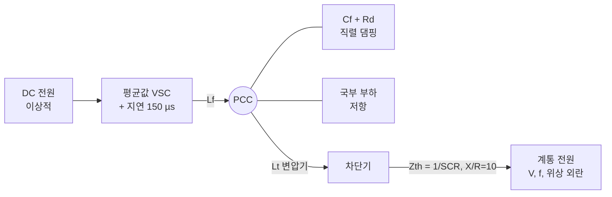

# GFM vs GFL EMT 시뮬레이션

> 요약: 같은 하드웨어와 같은 내부 전류제어기에 외부 루프만 바꿔 계통추종(GFL)과 계통형성(GFM) 인버터를 비교하는 Python 평균값 EMT 모델이다. 위상 점프, RoCoF, 약계통, 3상 고장, 단독운전의 다섯 가지 계통 시험을 재현한다.
> 최종 갱신: 2026-11-01 · 상태: 초안 · 실행 시간: 전체 약 35초(4코어)

## 핵심 결과 (TL;DR)

| 시험 | GFL | GFM |
|---|---|---|
| 위상 점프 −20° (SCR 3) | 10 ms 내 유효전력 변화 거의 없음. PLL 측정 주파수가 54 Hz 한계까지 튐 | 10 ms 내 +0.63 pu 즉시 응답 (위상점프 전력) |
| 주파수 램프 −1 Hz/s | 드룹 응답이 측정 필터만큼 늦음. 합성관성(SI)을 더하면 개선되나 필터를 2 Hz로 늦춰야 안정 | 램프 0.25 s 시점 ΔP가 GFL보다 약 0.12 pu 큼 (관성분) |
| 약계통 (선로 트립) | PLL이 빠를수록 불안정 경계 SCR이 높아짐 (50 Hz PLL은 SCR 2에서 불안정) | SCR 1.2까지 안정 |
| 3상 고장 0.3 pu·150 ms | 전류제한 내 무효전류 주입, 빠른 회복(약 24 ms) | 전류제한 1.2 pu 유지, PCC 전압 더 높게 지지(최저 0.49 vs 0.22 pu), VSM 스윙으로 회복 느림(약 0.55 s) |
| 계통 분리 (단독운전) | 기준 전압을 잃고 주파수 이탈 → V/f 유지 실패 | 드룹 주파수 59.63 Hz, 1.00 pu 유지 |

지표 전체는 [results/summary.md](results/summary.md)에 있다. 이 결과는 아래 파라미터와 제어 구조에 대한 것이며, 일반화하려면 대상 설비 모델로 다시 검토해야 한다.

## 1. 모델 구조



- **공간벡터**: 3상 순시값을 복소 αβ 벡터 하나로 다룬다. 진폭 불변 변환이므로 |v| = 1 pu가 정격 상전압 진폭이다. 스위칭은 평균화했지만 기본파 이외의 전자기 과도(필터 공진, 직류 옵셋, 고조파 대역 상호작용)는 그대로 남는다.
- **적분**: 고정 스텝 RK4, dt = 50 µs. 상태 변수는 23개다.
- **단위**: 인버터 정격 기준 pu, 시간은 초, 정격 주파수는 60 Hz다.

### 1.1 공통 하드웨어·내부 루프

| 항목 | 값 | 비고 |
|---|---|---|
| Lf, Rf | 0.15, 0.005 pu | 컨버터측 필터 |
| Cf, Rd | 0.05 pu, 2.0 pu | 커패시터 + 직렬 댐핑 저항 |
| Lt, Rt | 0.10, 0.005 pu | 변압기 |
| 계통 | X = 1/SCR, X/R = 10 | 테브난 등가 |
| 전류제어 | dq PI, 대역폭 800 Hz | 피드포워드 없음 (아래 교훈 1) |
| 지연 | 150 µs 1차 지연 | 10 kHz 샘플 × 1.5 근사 |
| 전류 한계 | 1.2 pu | 원형 제한 |

### 1.2 GFL 외부 루프

- SRF-PLL(기본 20 Hz, ζ = 0.707, 주파수 ±10 % 제한)이 PCC 전압 위상을 추종한다.
- 전류 지령은 P 지령에서 계산하고, PCC 전압은 적분 제어로 Q 지령을 만든다.
- 선택 기능은 세 가지다. P-f 드룹 2 %는 RoCoF 시나리오에서만 켠다. 합성관성은 측정 주파수의 미분을 쓰며, 측정 필터는 2 Hz다. FRT는 0.85 pu 미만에서 진입하고 0.92 pu와 30 ms 유지 후 해제하며, 그동안 무효전류 0.95 × I_max를 고정 주입한다.

### 1.3 GFM 외부 루프

- VSM 스윙 방정식을 쓴다: $2H\,\dot{\Delta\omega} = P^* - P - D\,\Delta\omega$. 관성 H = 4 s, D = 50(드룹 2 %).
- 내부 기전력 E는 PCC 전압을 1 pu로 맞추는 적분 제어로 만든다.
- **동적 가상 인덕턴스**: $(X_v/\omega_b)\,\dot i = E - v - R_v i - j\omega X_v i$, Xv = 0.30 pu, Rv = 0.05 pu. 이 출력이 전류 지령이 되므로 GFM은 "가상 임피던스 뒤의 전압원"으로 동작한다.
- **전류 제한**: 가상 인덕턴스 전류를 1.2 pu로 원형 포화하고 anti-windup을 둔다. 제한 중에는 VSM 가속을 멈춰 위상 이탈을 줄인다. 이 보정을 끈 변형은 `GFM (보정 없음)`으로 비교한다.

자세한 제어 이론은 [GFL 제어 구조](../../docs/02-GFL/01-GFL-제어구조.md), [GFM 제어 구조](../../docs/03-GFM/01-GFM-제어구조.md), [전류 제한](../../docs/03-GFM/03-전류제한-고장대응.md) 문서를 참고한다.

## 2. 실행 방법

```bash
cd simulation/emt
pip install -r requirements.txt
python run_scenarios.py          # 그래프·요약 생성, 슬라이드 데이터 갱신
python test_emt.py               # 회귀 테스트 5종 (약 15초)
```

직접 실험하려면 다음과 같이 쓴다.

```python
from gfm_gfl_emt import Params, Scenario, simulate, steady_state
p = Params(scr=1.5, P_ref=0.8, f_pll=35)          # 파라미터는 dataclass 필드
x0 = steady_state("GFL", p)                         # 정상상태 웜스타트
sc = Scenario(t_end=1.0, grid_phase=lambda t: -0.35 if t > 0.2 else 0.0)
r = simulate("GFL", p, sc, x0=x0)                   # r["t"], r["P"], r["ia"] ...
```

## 3. 시나리오별 결과

모든 시나리오는 정상상태에서 출발해 t = 0(그래프 기준)에 외란을 준다.

### 3.1 위상 점프 −20° (SCR 3, P₀ = 0.5 pu)


- **GFM**: 계통 위상이 뒤로 밀리면 내부 기전력과의 각도 차가 커져 수 ms 안에 유효전력이 0.5 → 1.1 pu로 증가한다. 측정이나 제어 판단 없이 회로 법칙으로 나오는 응답이며, GB GC0137의 "Active Phase Jump Power"에 해당한다. 60~80 Hz 대역의 감쇠 진동은 동기기 고정자 전류의 직류 옵셋에 해당하는 전자기 과도로, 시정수는 약 20 ms다. 이후 약 1 Hz의 느린 스윙은 VSM 관성 모드다.
- **GFL**: 전류원이므로 유효전력은 지령 근처에 머문다. PLL 측정 주파수는 순간적으로 54 Hz 한계까지 튄다. 이 값에 드룹이나 보호가 반응하면 오동작이 생길 수 있으며, NERC가 지적한 IBR 탈락 사례의 한 원인이다.


순시 상전류 파형은 EMT 모델의 특징을 보여준다. GFM은 점프 직후 반 주기 안에 전류 진폭이 두 배로 커지고, GFL은 파형이 잠시 일그러진 뒤 같은 진폭을 유지한다.

### 3.2 주파수 램프 −1 Hz/s × 0.5 s (SCR 5, P₀ = 0.3 pu)


| 방식 | 램프 0.25 s 시점 ΔP | 0.5 s 시점 ΔP |
|---|---|---|
| GFL (드룹) | +0.121 pu | +0.319 pu |
| GFL + 합성관성 | +0.197 pu | +0.445 pu |
| GFM (VSM) | +0.241 pu | +0.528 pu |

이론 관성분 $2H \cdot \mathrm{RoCoF}/f_0$은 0.133 pu다. GFM과 GFL의 차이(0.12 pu)가 이 값과 비슷하다. 합성관성은 GFL의 응답을 개선하지만 측정 필터 지연만큼 늦다. GFM은 램프 종료 후 관성 모드의 오버슈트가 있다.

### 3.3 약계통: 선로 트립 SCR 5 → 1.5 (P = 0.8 pu, GFL PLL 35 Hz)


GFL은 약 85 Hz의 지속 진동에 빠진다. 이는 PLL, 전류루프, 계통 임피던스의 상호작용이다. GFM은 VSM 스윙만 보이고 안정된다.


| 구성 | 불안정 경계 | 진동 형태 |
|---|---|---|
| GFL · PLL 10 Hz | SCR 1.3 이하 | 약 10 Hz 대진폭 (동기화 상실형) |
| GFL · PLL 35 Hz | SCR 1.5 이하 | 약 85 Hz 지속 진동 |
| GFL · PLL 50 Hz | SCR 2.0 이하 | 약 75~100 Hz 지속 진동 |
| GFM · VSM | SCR 1.2까지 안정 | — |

"PLL이 빠를수록 약계통에 취약하다"는 문헌의 결론과 같은 경향이다. 이 실험에서는 FRT 진입 전압을 0.5 pu로 낮춰 FRT 모드 순환을 배제했다(교훈 4).

### 3.4 3상 고장: 계통 전압 0.3 pu × 150 ms (SCR 3, P₀ = 0.8 pu)


- **GFM**: 고장 즉시 전류가 1.2 pu에서 포화된다. 전압원 특성 덕분에 PCC 전압을 0.7 pu 안팎으로 지지한다. 고장 제거 후 VSM 스윙으로 약 0.55 s에 걸쳐 회복한다.
- **GFM (보정 없음)**: 제한 중 VSM이 계속 가속해 위상 이탈이 38°에서 47°로 커진다. 고장 제거 후에도 포화가 0.33 s까지 이어진다. 제한 중 위상 루프 보정이 필요하다는 근거다.
- **GFL**: 고정 무효전류를 주입하고, 고장 제거 후 약 24 ms 만에 지령으로 복귀한다. 회복은 빠르지만, 고장 중 계통에 주는 전압 지지는 GFM보다 약하다.
- 고장 순간 전류 피크는 1.34~1.35 pu로, 내부 루프 지연 때문에 한계를 잠깐 넘는다. 실제 설비는 하드웨어 과전류 보호와 반도체 순간 정격으로 이를 처리한다.

### 3.5 계통 분리 (단독운전): 국부 부하 0.8 pu, P* = 0.5 pu


GFM은 부하 전체를 즉시 떠맡고, 드룹에 따라 f = 60 × (1 + 0.02 × (0.5 − 0.8)) = 59.64 Hz로 정착한다. GFL은 전압 크기는 0.98 pu로 유지하지만, 따라갈 기준 전압이 사라져 PLL 주파수가 하한 54 Hz까지 이탈한다. 이는 NERC·AEMO GFM 시험의 "최후 동기기 상실" 항목에 해당한다.

이 시나리오도 FRT 진입을 0.5 pu로 낮췄다. 기본 FRT 설정에서는 분리 직후 저전압으로 FRT가 켜지고, 고정 무효전류가 1.4 pu 과전압을 만들어 FRT가 꺼지기를 반복한다. 그 결과 전압과 주파수가 54~66 Hz 사이에서 함께 요동한다(교훈 4).

## 4. 모델링 과정에서 얻은 교훈

튜닝 중 관찰한 현상들은 실제 설비 설계에서도 반복되는 문제이므로 기록해 둔다.

1. **지연과 전압 피드포워드**: 150~300 µs 지연이 있는 상태에서 PCC 전압을 순시 피드포워드하면 GFL·GFM 모두 SCR 2 근처에서 100~200 Hz로 불안정해졌다. 피드포워드를 빼자 해결되었다. 약계통에서는 내부 전류루프 설계가 외부 루프보다 먼저 안정도를 좌우할 수 있다.
2. **PLL 주파수에 건 드룹**: GFL 드룹을 5 Hz 필터 PLL 주파수에 걸었더니 위상 점프 때 측정 주파수 급변에 반응해 출력이 0.5 pu 튀었다. 같은 설정은 약계통 불안정도 일으켰다.
3. **합성관성의 대가**: 측정 필터를 5 Hz로 두면 합성관성 루프가 불안정했고, 2 Hz로 늦춰야 안정했다. 측정 기반 관성은 안정을 위해 지연을 감수해야 한다. 이것이 GFM 관성과의 본질적 차이다.
4. **FRT 모드 순환**: 약계통 선로 트립이나 계통 분리 직후 순간 저전압으로 FRT가 켜지면, 고정 무효전류 주입으로 과전압이 되고 FRT가 꺼지는 순환이 반복되었다. 측정 전압에 비례하는 무효전류(k-factor)도 약계통에서는 루프 이득이 1을 넘어 진동했다.
5. **GFM과 LCL 공진**: 가상 어드미턴스에 순시 PCC 전압을 넣으면 Rd = 1 pu에서 약 500 Hz로 불안정했다. 커패시터 댐핑을 Rd = 2 pu로 늘려 해결했다. GFM이라고 고주파 상호작용에서 자유로운 것은 아니다.
6. **GFM의 느린 회복**: 고장 후 GFM의 유효전력 회복은 VSM 관성 때문에 GFL보다 느리다. 계통코드가 요구하는 회복 시간과 관성 설정 사이의 절충이 필요하다.

## 5. 검증과 한계

**검증**: `test_emt.py`의 회귀 테스트 5종은 다음을 확인한다.

- 정상상태 지령 추종.
- 정상상태 위상차가 페이저 이론식 $P = V^2/X \sin\delta$와 2° 이내로 일치.
- GFM의 위상점프 전력이 즉시 나오고 GFL은 거의 없음.
- 단독운전 시 GFM의 드룹 주파수가 이론값과 일치.
- 고장 중 GFM 전류 제한과 고장 후 동기 유지.

**한계**: 다음 요소는 모델에 없다.

- **스위칭과 직류측**: 스위칭 고조파와 DC링크 동역학이 없다. DC 전원은 이상적이다.
- **불평형**: 3상 평형만 다룬다. 역상 성분과 불평형 고장은 다루지 않는다.
- **보호**: 보호계전기와 주파수·전압 트립 로직이 없다.
- **플랜트 구성**: 단일 인버터 등가다. 다수 인버터 간 상호작용과 집전망은 없다.
- **파라미터 의존성**: 결론은 위 파라미터에 대한 것이다. 실제 연계 검토에는 제조사 EMT 모델(PSCAD, PowerFactory 등)과 계통운영자 시험 절차를 써야 한다. → [시험·검증 방법](../../docs/07-시험-검증/01-시험-검증-방법.md)

## 6. 파일 구성

| 파일 | 내용 |
|---|---|
| `gfm_gfl_emt.py` | 모델 본체 (Params, Scenario, simulate, steady_state) |
| `run_scenarios.py` | 시나리오 실행, 그래프·요약·슬라이드 데이터 생성 |
| `test_emt.py` | 회귀 테스트 |
| `results/` | 그래프(fig01~07), `summary.md`, `emt_results.json` |
