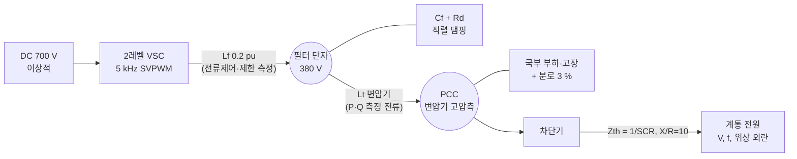
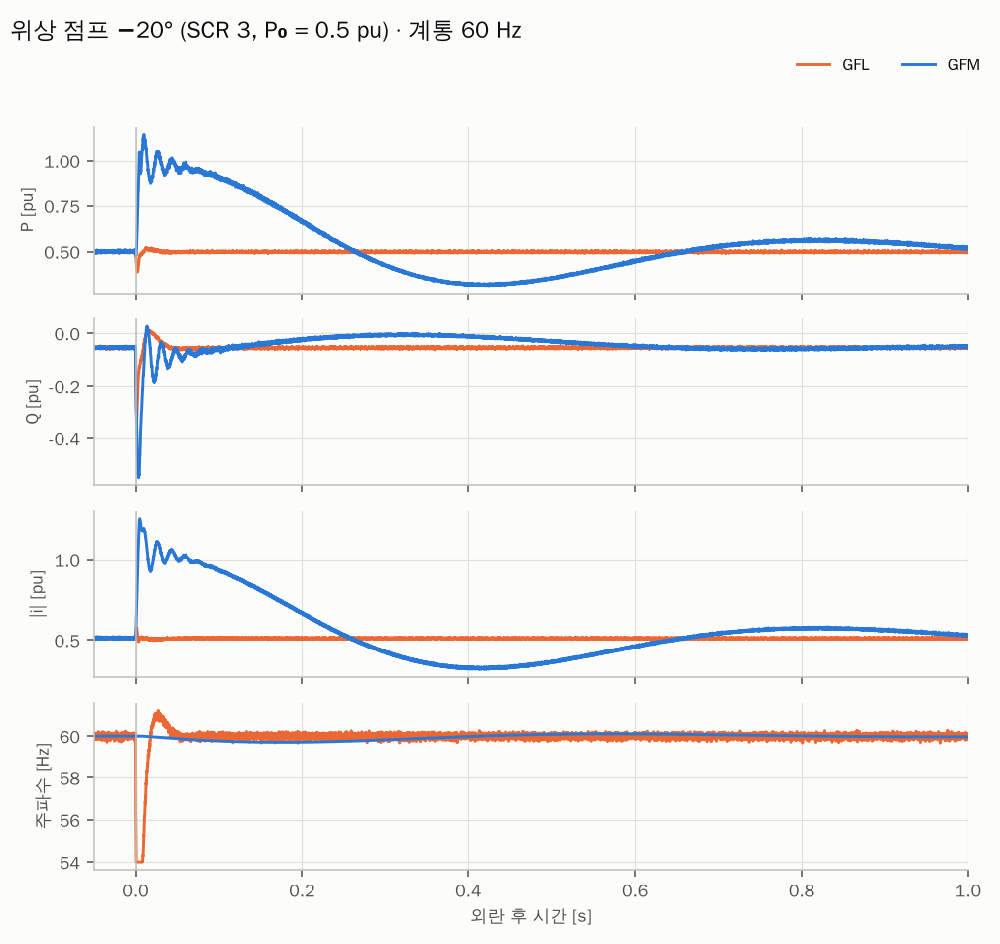
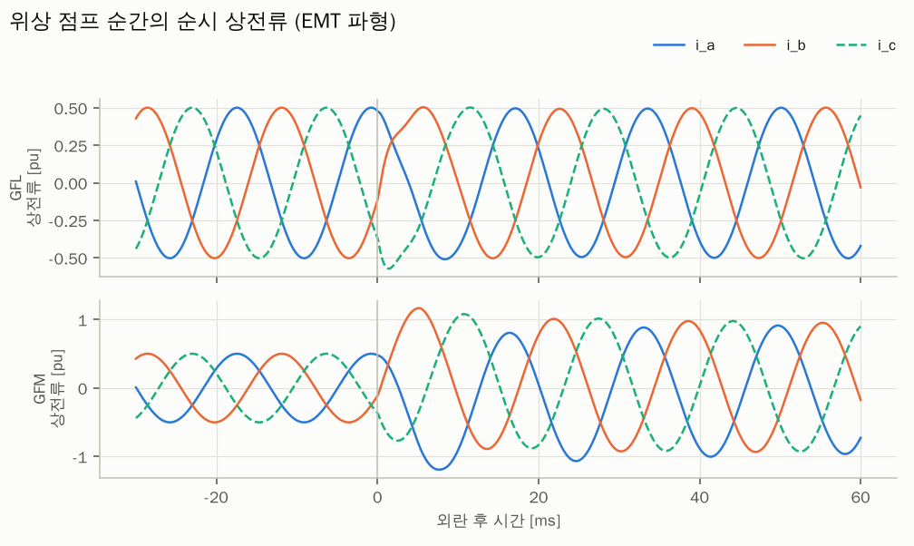
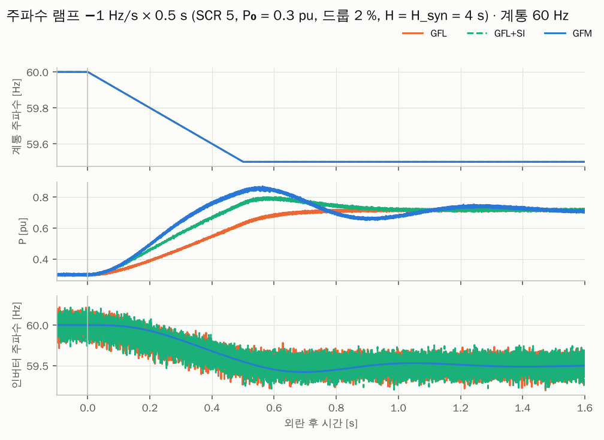
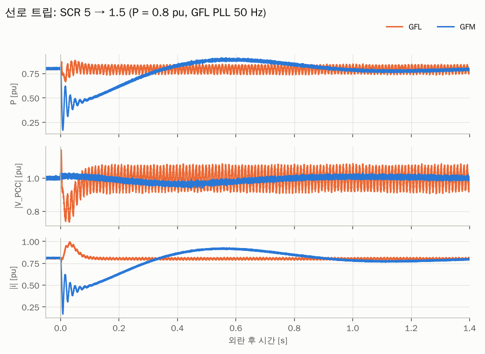
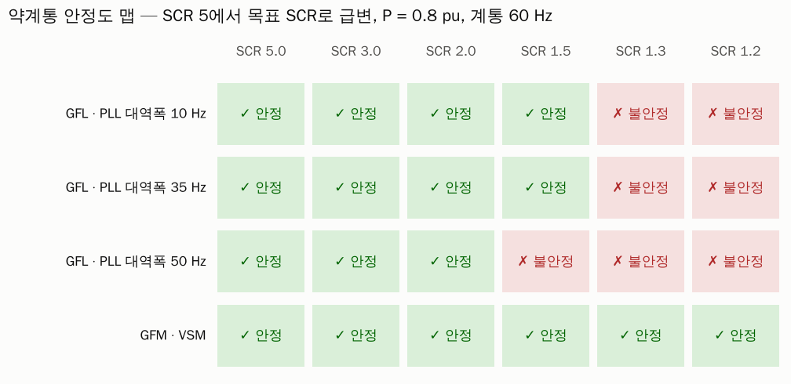
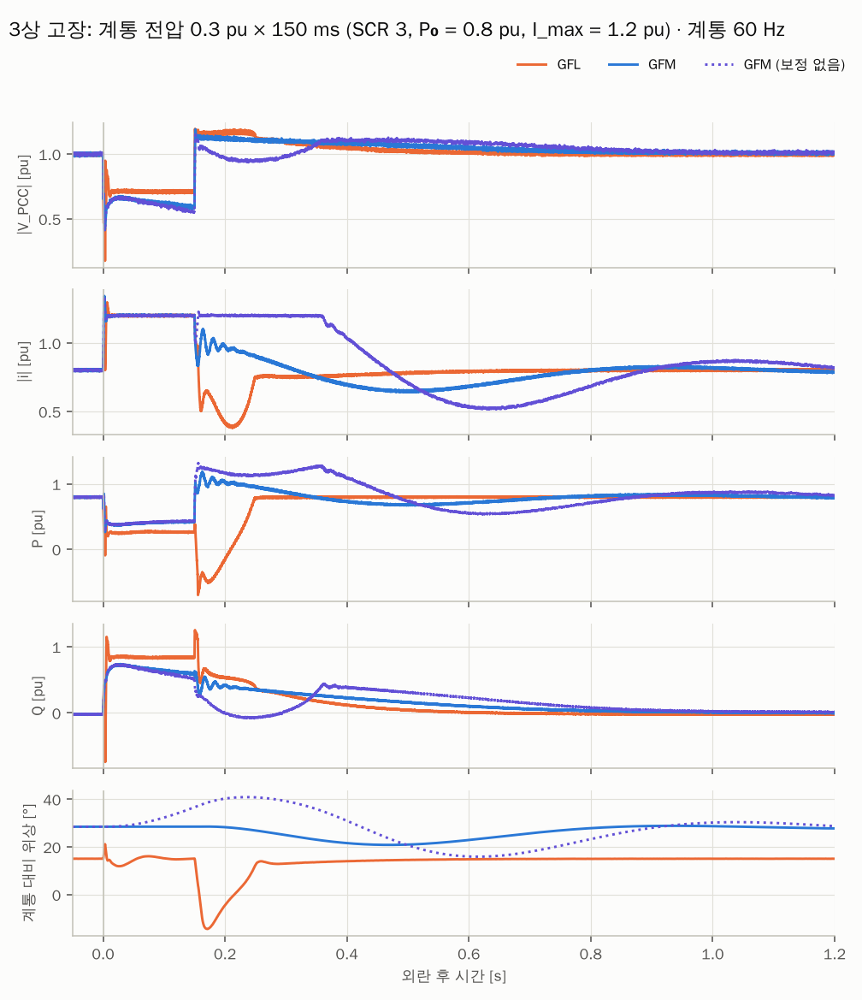
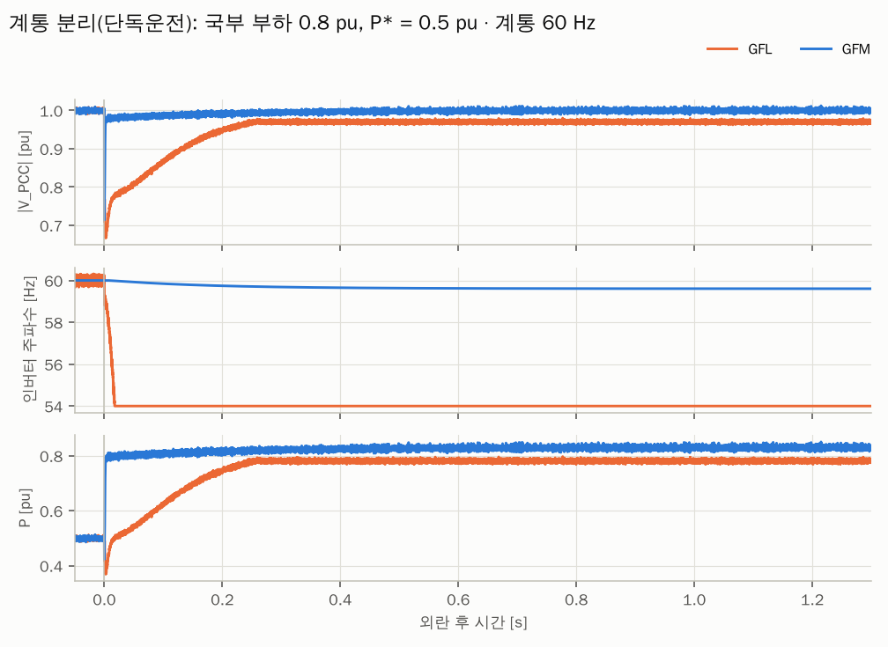

# GFM vs GFL EMT 시뮬레이션

> 요약: 같은 하드웨어와 같은 내부 전류제어기에 외부 루프만 바꿔 계통추종(GFL)과 계통형성(GFM) 인버터를 비교하는 Python EMT 모델이다. 2레벨 VSC를 5 kHz PWM으로 스위칭하고 해석 시간 간격 2 µs로 푼다. 위상 점프, RoCoF, 약계통, 3상 고장, 단독운전 시나리오와 표준 기반 시험 13종을 재현한다.
> 최종 갱신: 2026-11-01 · 상태: 초안 · 실행 시간: 시나리오 약 10분, 표준 시험 약 8분(4코어)

## 핵심 결과 (TL;DR)

5 kHz 스위칭 모델, 해석 간격 2 µs, 계통 60 Hz 기준이다.

| 시험 | GFL | GFM |
|---|---|---|
| 위상 점프 −20° (SCR 3) | 10 ms 내 유효전력 변화 +0.01 pu. PLL 측정 주파수가 54 Hz 한계까지 튐 | 10 ms 내 +0.64 pu 즉시 응답 (위상점프 전력) |
| 주파수 램프 −1 Hz/s | 드룹 응답이 측정 필터만큼 늦음. 합성관성(SI)을 더하면 개선되나 필터를 2 Hz로 늦춰야 안정 | 램프 0.25 s 시점 ΔP가 GFL보다 약 0.14 pu 큼 (관성분) |
| 약계통 (선로 트립) | PLL 대역폭이 클수록 불안정 경계 SCR이 높아짐 (50 Hz는 SCR 1.5에서 90 Hz 지속 진동) | SCR 1.2까지 안정 |
| 3상 고장 0.3 pu·150 ms | 고정 무효전류 주입으로 고장 중 평균 PCC 전압 0.71 pu, 회복 약 0.1 s | 전류 1.2 pu 제한, 고장 중 평균 PCC 전압 0.63 pu, VSM 스윙으로 회복 약 0.48 s |
| 계통 분리 (단독운전) | 기준 전압을 잃고 주파수가 54 Hz 하한까지 이탈 | 드룹 주파수 59.6 Hz, 1.00 pu 유지 |
| 표준 기반 시험 13종(14건) | 3건 적합 | 12건 적합 (60° 내성, 1.2 pu 정격의 한국 기준안 고장전류 부적합) |

지표 전체는 [results/summary.md](results/summary.md), 표준 시험은 [시험 결과 보고서](../../reports/gfm-gfl-test-report.html), 해석 간격 수렴은 [results/convergence.md](results/convergence.md)에 있다. 이 결과는 아래 파라미터와 제어 구조에 대한 것이며, 일반화하려면 대상 설비 모델로 다시 검토해야 한다.

## 1. 모델 구조



- **측정점**: 제어기의 P·Q·V, GFL의 PLL, GFM의 가상 어드미턴스 전압은 모두 **PCC 전압과 변압기 전류**로 측정한다. 컨버터측 전류(Lf)는 스위칭 리플이 커서 전류 제어와 전류 제한에만 쓴다. 처음에는 Lf 전류와 필터 단자 전압으로 전력을 쟀는데, 360·720·1080 Hz 에일리어싱 잡음(표준편차 약 0.010 pu)이 섞여 안정도 판정을 오염시켰다. 변압기 측정으로 바꾸자 잡음이 약 0.004 pu로 줄었다.
- **PCC 모선**: 국부 부하와 PCC 고장은 변압기 고압측 모선에 연결한다. 단독운전 시에도 변압기 전류가 부하로 흐르므로 측정 전력이 실제 출력과 같다. 모선에는 3 % 저항성 분로(보조 부하·손실 등가)를 상시 두어, 부하가 없을 때도 같은 방정식으로 풀리게 했다.

- **공간벡터**: 3상 순시값을 복소 αβ 벡터 하나로 다룬다. 진폭 불변 변환이므로 |v| = 1 pu가 정격 상전압 진폭이다.
- **전압 기준**: DC 링크 700 V, AC 380 V(선간 실효값)다. 1 pu 상전압 진폭은 310.3 V이고, SVPWM 선형영역 최대 출력은 700/√3 = 404.1 V, 즉 **1.303 pu**다.
- **스위칭**: 상별로 변조파를 5 kHz 삼각파 반송파와 비교해 극전압 ±350 V를 낸다. min-max 영상분을 주입하므로 SVPWM과 같은 전압 이용률을 갖는다. 스위칭 시점은 해석 스텝 경계로 양자화된다(2 µs, 반송파 주기의 1 %).
- **디지털 제어**: 반송파 꼭짓점(10 kHz, 2회 갱신)에서 PCC 전압과 컨버터 전류를 샘플-홀드한다. 계산한 전압 지령은 다음 샘플부터 적용하므로 계산·PWM 지연 약 1.5 샘플(150 µs)이 자연스럽게 생긴다.
- **적분**: 고정 스텝 RK4, **dt = 2 µs**다. 결과는 100 µs마다 기록하는데, 반송파 꼭짓점과 동기되므로 기록값은 리플 평균값에 해당한다. 위상 점프 등 일부 구간은 2 µs 순시 파형도 따로 저장한다.
- **평균값 모델**: `Params(converter="average")`로 바꾸면 스위칭을 평균화하고 지연을 1차 지연으로 근사한다. 회귀 테스트와 빠른 검토에 쓴다.
- **단위**: 인버터 정격 기준 pu, 시간은 초, 정격 주파수는 60 Hz다. 용량(MVA)은 지정하지 않았으며, 아래 pu 값이 맞는 설비라면 정격과 관계없이 같은 결과다.

### 1.1 공통 하드웨어·내부 루프

| 항목 | 값 | 비고 |
|---|---|---|
| Lf, Rf | 0.20, 0.005 pu | 컨버터측 필터 (5 kHz 리플 약 0.1 pu 피크-피크) |
| Cf, Rd | 0.05 pu, 2.0 pu | 커패시터 + 직렬 댐핑 저항 |
| Lt, Rt | 0.10, 0.005 pu | 변압기 (전력 측정 지점) |
| PCC 분로 | 0.03 pu 저항성 | 보조 부하·손실 등가 |
| 계통 | X = 1/SCR, X/R = 10 | 테브난 등가 |
| 전류제어 | dq PI, 대역폭 800 Hz | 피드포워드 없음 (아래 교훈 1) |
| 스위칭 / 샘플링 | 5 kHz / 10 kHz | 2레벨 SVPWM 등가, 1샘플 계산 지연 |
| 전압 | DC 700 V, AC 380 V | 최대 출력 1.303 pu |
| 전류 한계 | 1.2 pu | 원형 제한 |

### 1.2 GFL 외부 루프

- SRF-PLL(기본 20 Hz, ζ = 0.707, 주파수 ±10 % 제한)이 PCC 전압 위상을 추종한다.
- 전류 지령은 P 지령에서 계산하고, PCC 전압은 적분 제어로 Q 지령을 만든다.
- 선택 기능은 세 가지다. P-f 드룹 2 %는 RoCoF 시나리오에서만 켠다. 합성관성은 측정 주파수의 미분을 쓰며, 측정 필터는 2 Hz다. FRT는 0.85 pu 미만에서 진입하고 0.92 pu와 30 ms 유지 후 해제하며, 그동안 무효전류 0.95 × I_max를 고정 주입한다.

### 1.3 GFM 외부 루프

- VSM 스윙 방정식을 쓴다: $2H\,\dot{\Delta\omega} = P^* - P - D\,\Delta\omega$. 관성 H = 4 s, D = 50(드룹 2 %).
- 내부 기전력 E는 PCC 전압을 1 pu로 맞추는 적분 제어로 만든다.
- **동적 가상 인덕턴스**: $(X_v/\omega_b)\,\dot i = E - v - R_v i - j\omega X_v i$, Xv = 0.30 pu, Rv = 0.05 pu. 이 출력이 전류 지령이 되므로 GFM은 "가상 임피던스 뒤의 전압원"으로 동작한다.
- **전류 제한**: 가상 인덕턴스 전류를 1.2 pu로 원형 포화하고 anti-windup을 둔다. 제한 중에는 VSM 가속을 멈춰 위상 이탈을 줄인다. 이 보정을 끈 변형은 `GFM (보정 없음)`으로 비교한다.

자세한 제어 이론은 [GFL 제어 구조](../../docs/02-GFL/01-GFL-제어구조.md), [GFM 제어 구조](../../docs/03-GFM/01-GFM-제어구조.md), [전류 제한](../../docs/03-GFM/03-전류제한-고장대응.md) 문서를 참고한다.

## 2. 실행 방법

```bash
cd simulation/emt
pip install -r requirements.txt
python run_scenarios.py          # 그래프·요약 생성, 슬라이드 데이터 갱신
python test_emt.py               # 회귀 테스트 5종 (약 15초)
```

직접 실험하려면 다음과 같이 쓴다.

```python
from gfm_gfl_emt import Params, Scenario, simulate, steady_state
p = Params(scr=1.5, P_ref=0.8, f_pll=35)          # 파라미터는 dataclass 필드
x0 = steady_state("GFL", p)                         # 정상상태 웜스타트
sc = Scenario(t_end=1.0, grid_phase=lambda t: -0.35 if t > 0.2 else 0.0)
r = simulate("GFL", p, sc, x0=x0)                   # r["t"], r["P"], r["ia"] ...
```

## 3. 시나리오별 결과

모든 시나리오는 정상상태에서 출발해 t = 0(그래프 기준)에 외란을 준다. 수치는 2 µs 스위칭 모델 결과다.

### 3.1 위상 점프 −20° (SCR 3, P₀ = 0.5 pu)



- **GFM**: 계통 위상이 뒤로 밀리면 내부 기전력과의 각도 차가 커져, 10 ms 안에 유효전력이 0.64 pu 늘어난다. 측정이나 제어 판단 없이 회로 법칙으로 나오는 응답이며, GB GC0137의 "Active Phase Jump Power"에 해당한다. 60~80 Hz 대역의 감쇠 진동은 동기기 고정자 전류의 직류 옵셋에 해당하는 전자기 과도이고, 이후 약 1.3 Hz의 느린 스윙(감쇠비 약 31 %)은 VSM 관성 모드다.
- **GFL**: 전류원이므로 유효전력은 지령 근처에 머문다(+0.01 pu). PLL 측정 주파수는 순간적으로 54 Hz 한계까지 튄다. 이 값에 드룹이나 보호가 반응하면 오동작할 수 있다.



순시 상전류에는 5 kHz 스위칭 리플(약 0.1 pu 피크-피크)이 실려 있다. GFM은 점프 직후 반 주기 안에 전류 진폭이 두 배 가까이 커지고, GFL은 파형이 잠시 일그러진 뒤 같은 진폭을 유지한다.

### 3.2 주파수 램프 −1 Hz/s × 0.5 s (SCR 5, P₀ = 0.3 pu)



| 방식 | 램프 0.25 s 시점 ΔP | 0.5 s 시점 ΔP |
|---|---|---|
| GFL (드룹) | +0.126 pu | +0.328 pu |
| GFL + 합성관성 | +0.213 pu | +0.458 pu |
| GFM (VSM) | +0.269 pu | +0.538 pu |

이론 관성분 $2H \cdot \mathrm{RoCoF}/f_0$은 0.133 pu이고, GFM과 GFL의 차이(0.14 pu)가 이와 비슷하다. 합성관성은 GFL의 응답을 개선하지만 측정 필터 지연만큼 늦다.

### 3.3 약계통: 선로 트립 SCR 5 → 1.5 (P = 0.8 pu, GFL PLL 대역폭 50 Hz)



GFL은 약 90 Hz의 지속 진동(진폭 0.04 pu)에 빠진다. PLL, 전류루프, 계통 임피던스의 상호작용이다. GFM은 VSM 스윙만 보이고 안정된다.



| 구성 | 불안정 경계 | 진동 형태 |
|---|---|---|
| GFL · PLL 대역폭 10 Hz | SCR 1.3 이하 | 약 10 Hz 대진폭 (동기화 상실형) |
| GFL · PLL 대역폭 35 Hz | SCR 1.3 이하 | 상호작용형 |
| GFL · PLL 대역폭 50 Hz | SCR 1.5 이하 | 약 90 Hz 지속 진동 |
| GFM · VSM | SCR 1.2까지 안정 | — |

"PLL이 빠를수록 약계통에 취약하다"는 문헌의 결론과 같은 경향이다. 이 실험에서는 FRT 진입 전압을 0.5 pu로 낮춰 FRT 모드 순환을 배제했다(교훈 4). 평균값 모델은 경계 SCR이 다르게 나오므로 경향만 비교한다.

### 3.4 3상 고장: 계통 전압 0.3 pu × 150 ms (SCR 3, P₀ = 0.8 pu)



- **GFM**: 고장 즉시 전류가 1.2 pu에서 포화되고, 전류 방향을 유지한 채 크기만 제한한다. 고장 구간 평균 PCC 전압은 0.63 pu다. 고장 제거 후 VSM 스윙으로 약 0.48 s에 걸쳐 회복한다.
- **GFM (보정 없음)**: 제한 중 VSM 가속을 멈추지 않으면 위상 이탈이 커지고 회복이 약 0.95 s로 늘어난다.
- **GFL**: FRT로 무효전류 0.95 × 1.2 pu를 고정 주입하므로 고장 구간 평균 PCC 전압이 0.71 pu로 GFM보다 높다. 고장 제거 후 약 0.1 s 만에 지령으로 복귀한다.
- 이전 평균값 모델 문서에는 "GFM이 고장 중 전압을 더 높게 지지한다"고 적었으나, 측정점과 디지털 제어를 바로잡은 스위칭 모델에서는 반대였다. 전류 제한 중에는 전류의 크기와 각도가 전압 지지를 정한다.
- 고장 순간 전류 피크는 1.30~1.34 pu로, 디지털 제어 지연 때문에 한계를 잠깐 넘는다.

### 3.5 계통 분리 (단독운전): 국부 부하 0.8 pu, P* = 0.5 pu



GFM은 부하 전체를 즉시 떠맡고 드룹에 따라 59.6 Hz, 1.00 pu로 정착한다(이론 60 × (1 + 0.02 × (0.5 − 0.83)), PCC 분로 3 % 포함). GFL은 전압 크기는 0.97 pu로 유지하지만, 따라갈 기준 전압이 사라져 PLL 주파수가 하한 54 Hz까지 이탈한다. NERC·AEMO GFM 시험의 "최후 동기기 상실" 항목에 해당한다. 이 시나리오도 FRT 진입을 0.5 pu로 낮춰 FRT 순환과 분리했다.

## 4. 모델링 과정에서 얻은 교훈

튜닝 중 관찰한 현상들은 실제 설비 설계에서도 반복되는 문제이므로 기록해 둔다.

1. **지연과 전압 피드포워드**: 150~300 µs 지연이 있는 상태에서 PCC 전압을 순시 피드포워드하면 GFL·GFM 모두 SCR 2 근처에서 100~200 Hz로 불안정해졌다. 피드포워드를 빼자 해결되었다. 약계통에서는 내부 전류루프 설계가 외부 루프보다 먼저 안정도를 좌우할 수 있다.
2. **PLL 주파수에 건 드룹**: GFL 드룹을 5 Hz 필터 PLL 주파수에 걸었더니 위상 점프 때 측정 주파수 급변에 반응해 출력이 0.5 pu 튀었다. 같은 설정은 약계통 불안정도 일으켰다.
3. **합성관성의 대가**: 측정 필터를 5 Hz로 두면 합성관성 루프가 불안정했고, 2 Hz로 늦춰야 안정했다. 측정 기반 관성은 안정을 위해 지연을 감수해야 한다. 이것이 GFM 관성과의 본질적 차이다.
4. **FRT 모드 순환**: 약계통 선로 트립이나 계통 분리 직후 순간 저전압으로 FRT가 켜지면, 고정 무효전류 주입으로 과전압이 되고 FRT가 꺼지는 순환이 반복되었다. 측정 전압에 비례하는 무효전류(k-factor)도 약계통에서는 루프 이득이 1을 넘어 진동했다.
5. **GFM과 LCL 공진**: 가상 어드미턴스에 순시 PCC 전압을 넣으면 Rd = 1 pu에서 약 500 Hz로 불안정했다. 커패시터 댐핑을 Rd = 2 pu로 늘려 해결했다. GFM이라고 고주파 상호작용에서 자유로운 것은 아니다.
6. **GFM의 느린 회복**: 고장 후 GFM의 유효전력 회복은 VSM 관성 때문에 GFL보다 느리다. 계통코드가 요구하는 회복 시간과 관성 설정 사이의 절충이 필요하다.
7. **측정점**: 스위칭 리플이 큰 컨버터측(Lf) 전류와 필터 단자 전압으로 전력을 쟀더니 360 Hz 배수의 에일리어싱 잡음이 섞여 강계통 GFM이 '불안정'으로 잘못 판정되었다. 변압기 전류·PCC 전압으로 옮기자 잡음이 약 절반으로 줄었다.
8. **디지털 제어의 각도**: 샘플-홀드된 측정을 연속으로 회전하는 각도로 dq 변환하면 v_q가 샘플 주기 안에서 톱니처럼 흘러 PLL 주파수에 kp·ω·Ts/2 오프셋이 생겼다(PLL 대역폭 50 Hz에서 61.35 Hz). 샘플 시점 각 고정과 1.5 Ts 회전 보상으로 해결했다.
9. **전류 제한 고착**: 제한 중 VSM 가속을 멈추는 보정은 고장 회복을 빠르게 하지만, 지속되는 60° 위상차에서는 재동기에 필요한 각도 이동까지 막아 전류 제한 상태에 갇히게 했다(표준 시험 T09). 과도 가상 임피던스 등 제한 중에도 전력-위상 관계를 유지하는 방식이 필요하다.
10. **전압 적분기 와인드업**: 내부 기전력 E만 제한하고 적분기를 그대로 두면, PCC 지락 제거 후 PCC 전압이 약 1.14 pu로 1초 가까이 머물렀다. 적분기 anti-windup을 추가했다.
11. **해석 간격과 지표**: 고장 중 순간 최저 전압은 해석 간격에 따라 흔들려(GFL 0.14~0.18 pu) 구간 평균으로 바꿨다. 약계통 진동 지표는 10 µs에서 크게 부풀려졌다가 2 µs 이하에서 수렴했다([수렴표](results/convergence.md)).

교훈 1의 피드포워드 불안정은 평균값 모델 시절 기록이다. 현재 스위칭 모델에서는 GFM만 약 560 Hz로 불안정해지고 GFL은 안정했다(C07 강의 참고).

## 5. 검증과 한계

**검증**: `test_emt.py`의 회귀 테스트 6종(약 2분)은 다음을 확인한다. 물리 성질 5종은 빠른 평균값 모델(10 µs)로, 마지막 1종은 스위칭 모델(2 µs)로 돈다.

- 정상상태 지령 추종.
- PCC–계통 위상차가 페이저 이론식 $P = V^2/X \sin\delta$와 2° 이내로 일치.
- GFM의 위상점프 전력이 즉시 나오고 GFL은 거의 없음.
- 단독운전 시 GFM의 드룹 주파수가 이론값과 일치.
- 고장 중 GFM 전류 제한과 고장 후 동기 유지.
- 스위칭 모델의 정상상태 추종, 5 kHz 리플 존재, 변조 한계 1.303 pu.

`convergence.py`는 10·5·2·1 µs에서 같은 시나리오의 핵심 지표를 비교한다([results/convergence.md](results/convergence.md)).

**한계**: 다음 요소는 모델에 없다.

- **직류측**: DC 링크는 2.256 pu 이상적 전원이다. DC 전압 변동과 배터리 SOC 제약은 없다.
- **불평형**: 3상 평형만 다룬다. 역상 성분과 불평형 고장은 다루지 않는다.
- **보호**: 보호계전기와 주파수·전압 트립 로직이 없다.
- **플랜트 구성**: 단일 인버터 등가다. 다수 인버터 간 상호작용과 집전망은 없다.
- **캐시**: 정상상태 캐시 키에 코드가 들어가지 않는다. 모델 코드를 바꾸면 `.cache/`를 지우고 다시 돌린다.
- **파라미터 의존성**: 결론은 위 파라미터에 대한 것이다. 실제 연계 검토에는 제조사 EMT 모델과 계통운영자 시험 절차를 써야 한다. → [시험·검증 방법](../../docs/07-시험-검증/01-시험-검증-방법.md)

## 6. 파일 구성

| 파일 | 내용 |
|---|---|
| `gfm_gfl_emt.py` | 모델 본체 (Params, Scenario, simulate, steady_state) |
| `run_scenarios.py` | 시나리오 실행, 그래프·요약·슬라이드 데이터 생성 |
| `test_emt.py` | 회귀 테스트 |
| `compliance_tests.py` | 표준 기반 시험 13종, 보고서 데이터 생성 |
| `convergence.py` | 해석 간격 수렴 확인 |
| `results/` | 그래프(fig01~07), `summary.md`, `emt_results.json`, `compliance.json`, `convergence.md` |
